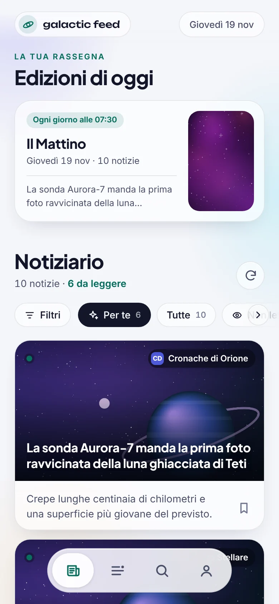
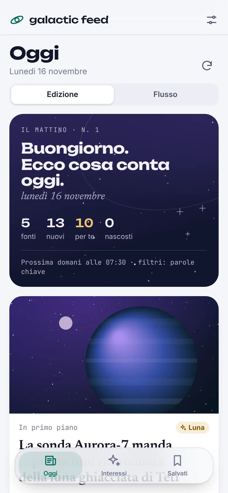
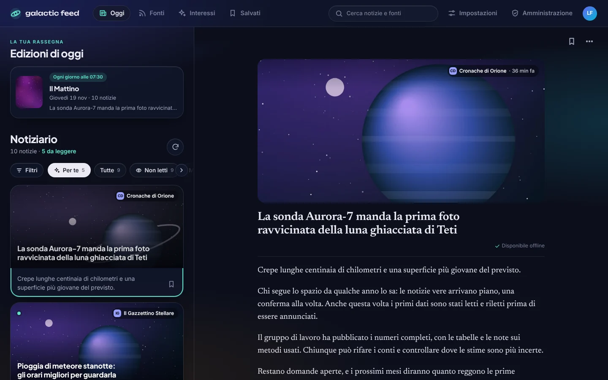

# Galactic Feed

[](CHANGELOG.md)
[](https://github.com/TehMaat/galactic-feed/actions/workflows/test.yml)
[](docs/installazione.md)
[](docs/come-e-fatto.md)

Lettore di notizie self-hosted e multiutente. Il server raccoglie feed RSS/Atom e canali YouTube, sceglie le notizie che ti interessano con parole chiave o con l'AI e toglie i doppioni. Se vuoi, agli orari che scegli compone un'**Edizione** in stile giornale e ti avvisa con una notifica. Le leggi da una PWA per telefono, tablet e computer, anche offline.

<p align="center">
  
  
  
</p>

<p align="center">
  
</p>

<sub>Screenshot con dati inventati: testate, articoli e persone non esistono.</sub>

## Cosa sa fare

- **Fonti**: siti, feed RSS/Atom e canali YouTube, in cartelle, con import ed export OPML. Ogni feed si scarica una volta sola, anche se lo seguono in tanti.
- **Per te**: interessi con parole chiave e gruppi di parole pronti, parole silenziate, filtro con l'AI (locale o cloud), unione dei doppioni.
- **Edizioni**: una selezione in stile giornale, agli orari e nei giorni che scegli, con regole per tag, cartelle, nazioni e argomenti.
- **Lettura**: testo completo anche quando il feed dà solo un estratto, riassunti con l'AI, salvati e ultimi 300 letti disponibili offline.
- **Notifiche** push per le cartelle importanti, con il numero di non letti sull'icona.
- **Multiutente**: inviti, amministrazione da GUI, accesso con un provider OIDC (Authentik, Authelia, Keycloak, Pocket ID…).
- **Aspetto**: tema chiaro, scuro e nero per OLED, otto colori, font ad alta leggibilità.
- **Un solo container** Docker per amd64, arm64 (Raspberry Pi 4/5, Mac Apple Silicon) e armv7. I dati stanno in un file SQLite nel volume `/data`.

Interfaccia e documentazione in italiano.

## Installazione in 3 passi

Serve Docker con il plugin Compose.

1. Scarica il [`docker-compose.yml`](docker-compose.yml) in una cartella e cambia `PUBLIC_URL` con l'indirizzo da cui aprirai l'app (per esempio `https://notizie.example.org`). L'immagine è `ghcr.io/tehmaat/galactic-feed:0.13`.
2. Avvia e leggi il codice di primo avvio nel log:

   ```bash
   docker compose up -d
   ```

   ```bash
   docker compose logs galactic-feed
   ```

3. Apri l'indirizzo, inserisci il codice e crea il tuo account: sei l'amministratore. Gli altri li inviti da **Amministrazione → Utenti e inviti**.

Tutti i modi di installarlo (volume o cartella, `docker run`, Raspberry Pi, dietro un reverse proxy, da sorgente) sono in [docs/installazione.md](docs/installazione.md).

## Dove trovo…

| Cerco | Pagina |
|---|---|
| Installare, primo avvio, Raspberry Pi | [Installazione](docs/installazione.md) |
| Variabili d'ambiente e impostazioni | [Configurazione](docs/configurazione.md) |
| Aggiornare, copia dei dati, ripristino | [Aggiornare e backup](docs/aggiornare-e-backup.md) |
| HTTPS, Caddy, Nginx, Traefik, proxy con login | [Dietro un reverse proxy](docs/reverse-proxy.md) |
| Entrare con Authentik, Authelia, Keycloak… | [Accesso con OIDC](docs/accesso-oidc.md) |
| AI, Edizioni e notifiche | [AI, Edizioni e notifiche](docs/ai-edizioni-notifiche.md) |
| Interessi, tag, nazioni, aspetto, lettura | [Usare l'app](docs/usare-l-app.md) |
| Installare l'app su iPhone e Android | [L'app sul telefono](docs/app-sul-telefono.md) |
| Qualcosa non va | [Risoluzione dei problemi](docs/risoluzione-problemi.md) |
| Come è fatto il codice | [Architettura](docs/ARCHITETTURA.md) · [Sviluppo](docs/sviluppo.md) |
| Novità di ogni versione | [CHANGELOG.md](CHANGELOG.md) |

L'indice completo è in [docs/README.md](docs/README.md).

## Come è fatto

Galactic Feed è **Full Vibe Coded**: codice, test, workflow e documentazione li scrive l'AI (Claude Code), mentre una persona decide cosa fare, prova e approva. Ogni modifica parte da una issue e arriva come pull request, con test automatici, numero di versione e note nel [CHANGELOG](CHANGELOG.md) obbligatori; le regole per l'AI sono in [`CLAUDE.md`](CLAUDE.md). È un progetto personale: usalo sapendo com'è fatto. I dettagli sono in [Come è fatto](docs/come-e-fatto.md).
