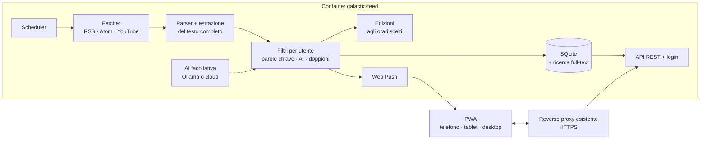

# Galactic Feed · analisi

Stato: **requisiti confermati il 31/10/2026**, dopo le risposte alle domande della prima bozza. La strada scelta è la **A: tutto su misura**.

## Obiettivo

Un lettore di notizie self-hosted, multiutente e di sola lettura:

- raccoglie feed RSS/Atom di siti e canali YouTube, aggiunti a mano da ogni utente;
- seleziona le notizie che interessano con parole chiave, con l'AI o con entrambe, a scelta;
- su richiesta compone un'**edizione** in stile newsletter agli orari scelti dall'utente;
- si legge da una GUI curata, adatta a iPhone, iPad e desktop, installabile come **PWA**;
- gira in **Docker** su qualsiasi macchina (Raspberry Pi, NAS, mini PC, VPS), dietro il reverse proxy che l'utente ha già.

**Sola lettura** vuol dire niente commenti, voti o link per commentare. Resta solo il link all'articolo originale, per chi vuole leggerlo sul sito.

## Decisioni

| Tema | Decisione |
|---|---|
| Strada | A: backend e PWA scritti da zero |
| Utenti | Multiutenza: ognuno ha fonti, interessi, letti, salvati ed edizioni propri |
| Fonti | Aggiunte a mano (vedi sotto); import/export OPML facoltativo |
| Reddit | **Dismesso**. Restano da valutare servizi a pagamento (vedi sotto) |
| Filtri | Parole chiave con priorità, AI, o entrambi: sceglie l'utente |
| AI | Facoltativa: modello locale (Ollama) o servizio cloud, a scelta. Riassunti compresi |
| Edizione | Facoltativa, orari scelti dall'utente, solo nell'app (niente email) |
| Lettura | Testo completo quando si riesce a estrarlo, lettura offline |
| Notifiche | Facoltative: l'utente sceglie le categorie importanti che le fanno partire |
| Dispositivi | PWA responsive per telefono, tablet e desktop |
| App nativa | Non ora. Vedi la postilla in fondo |
| HTTPS | Lo fa il reverse proxy esistente (l'utente userà Pangolin, ma il progetto non dipende da uno specifico) |
| Docker | Immagini per amd64 e arm64; armv7 se le dipendenze lo permettono |

## Architettura

Il telefono non fa lavoro pesante: su iOS una PWA non può aggiornarsi in background. Il server scarica, filtra e compone; la PWA mostra il risultato e riceve le notifiche.



Ogni feed viene scaricato **una volta sola** anche se lo seguono più utenti. Filtri, edizioni e notifiche invece sono calcolati per ogni utente.

## Stack

L'utente non ha preferenze e non intende modificare il codice, quindi scelgo strumenti diffusi e ben mantenuti.

- **Backend**: Python 3.12 con FastAPI. Per i feed feedparser e httpx; per il testo completo trafilatura; scheduler interno.
- **Database**: SQLite in modalità WAL con ricerca full-text FTS5, in un volume `/data`. Basta per una famiglia o un gruppo di amici; PostgreSQL resta un'opzione futura.
- **Frontend**: Svelte con Vite e vite-plugin-pwa (service worker, manifest, cache offline). Interfaccia in italiano.
- **Login**: account locali con password (hash argon2) e sessioni via cookie. Il primo utente creato è l'amministratore e invita gli altri. Login tramite il reverse proxy (SSO di Pangolin o header di autenticazione) da valutare in seguito.
- **Notifiche**: Web Push standard con chiavi VAPID generate al primo avvio.
- **AI**: un'interfaccia unica con due tipi di fornitore: endpoint compatibile OpenAI (Ollama in locale) oppure API cloud. L'amministratore configura il fornitore; ogni utente decide se usarlo.
- **Docker**: un solo container che serve API e PWA sulla porta 8080 in HTTP, con un volume `/data`. `docker compose up -d` e variabili d'ambiente come `PUBLIC_URL` e `TZ`.

Nota sull'AI: un modello locale su Raspberry Pi è molto lento. Su hardware piccolo conviene il cloud, oppure Ollama su un'altra macchina della rete.

## Dietro il reverse proxy

L'app non gestisce certificati. Il reverse proxy (Pangolin, Caddy, Traefik, Nginx Proxy Manager…) termina l'HTTPS e inoltra a `http://galactic-feed:8080`.

- HTTPS è obbligatorio per installare la PWA e ricevere le notifiche su iPhone.
- `PUBLIC_URL` deve contenere l'indirizzo pubblico, per manifest, link e notifiche.
- L'app legge gli header `X-Forwarded-*`. Non servono WebSocket.
- Se il proxy aggiunge un suo login davanti all'app, i percorsi `/manifest.webmanifest`, `/sw.js` e le icone devono restare raggiungibili, altrimenti iOS non riesce a installare la PWA.

## Fonti aggiunte a mano: ci sono problemi?

No, è il modo normale di usare un lettore RSS. Ci sono solo alcuni casi da conoscere:

- **Basta l'indirizzo del sito**: il server cerca da solo il feed nella pagina. Se ne trova più d'uno (tutte le notizie, una categoria, i commenti), l'utente sceglie.
- **Siti senza feed**: sempre meno comuni, ma esistono. Per ora non sono supportati. In seguito si può aggiungere un generatore di feed (per esempio un container RSSHub, o regole che leggono la pagina).
- **Feed con solo un estratto**: il server prova a scaricare l'articolo e a estrarre il testo completo. Sui siti a pagamento si vedrà solo l'estratto.
- **Siti che bloccano i programmi automatici**: alcuni rifiutano le richieste dei server. Nella schermata Fonti compare un errore chiaro.
- **YouTube**: ogni canale ha un feed pubblico, non serve un account.
- Il server rispetta gli header di cache dei siti e non li interroga più spesso del necessario.

## Reddit

Reddit spegne i feed RSS il **13 novembre 2026** e chiude per fasi l'accesso pubblico alle API fino a marzo 2027. Le nuove chiavi API vanno approvate, e gli script personali vengono spesso rifiutati. Per questo **Reddit esce dalla prima versione**.

Servizi a pagamento da valutare per un eventuale connettore, spento di default:

| Servizio | Prezzo indicativo | Stima per 5 subreddit | Note |
|---|---|---|---|
| API ufficiale Reddit, piano commerciale | 0,24 $ ogni 1.000 chiamate, con un minimo di circa 12.000 $ l'anno | fuori scala | Pensata per aziende; serve comunque l'approvazione |
| RedditAPI | circa 0,002 $ a lettura | ~7 $/mese controllando ogni ora | Prezzo a chiamata: il più adatto a un uso personale |
| Apify (scraper Reddit) | circa 1,90–2 $ ogni 1.000 risultati, 5 $ di credito gratuito al mese | ~25–30 $/mese controllando 4 volte al giorno | Paga per post restituito, quindi costa di più se si controlla spesso |
| SocialCrawl | 15 £ per 2.500 crediti che non scadono | ~2 mesi di crediti controllando ogni 3 ore, se 1 credito vale 1 chiamata | Crediti prepagati |

Le stime contano 5 subreddit, 25 post per controllo e 30 giorni. I prezzi vengono soprattutto da blog dei fornitori stessi e vanno verificati sulle loro pagine ufficiali.

**Termini d'uso**: i servizi di terze parti ottengono i dati da Reddit con metodi che Reddit non autorizza. Il rischio legale ricade soprattutto su di loro, ma il servizio può smettere di funzionare da un giorno all'altro. Se si decide di provarne uno, la proposta è un connettore facoltativo dove l'utente inserisce la propria chiave, disattivato di default e con un tetto di spesa. **Consiglio RedditAPI** per il prezzo a chiamata, da provare con pochi subreddit.

## Funzionalità

**Prima versione**

- Account e inviti, fonti per utente con cartelle, import/export OPML.
- Flusso cronologico con ricerca e filtri; letti/non letti; salvati.
- Lettura con testo completo e funzionamento offline.
- Interessi con priorità e parole silenziate; unione dei doppioni.
- Layout per telefono (barra in basso), tablet (barra laterale e lista) e desktop (fonti, lista e lettura affiancate).
- Tema chiaro, scuro e automatico.
- Docker multi-architettura e istruzioni per il reverse proxy.

**Seconda versione**

- Edizione facoltativa agli orari scelti dall'utente.
- Filtri e riassunti con l'AI, locale o cloud.
- Notifiche push per le categorie scelte come importanti, con il numero di non letti sull'icona.

**In seguito**

- Generatore di feed per i siti che non ne hanno.
- Eventuale connettore Reddit a pagamento.
- Login tramite il reverse proxy (SSO).

## Mockup

La cartella [`mockup/`](../mockup) contiene il prototipo cliccabile della GUI, da provare così:

```bash
python3 -m http.server 8000 --directory mockup
```

La versione 0.2 è allineata alle decisioni:

- niente Reddit, commenti o voti: solo siti, canali YouTube e il link all'articolo originale;
- selettore **Telefono / Tablet / Computer**. Su tablet la navigazione passa in una barra laterale; su computer navigazione, lista e lettura sono affiancate;
- **Interessi**: scelta tra parole chiave, AI o entrambi, e una descrizione libera per l'AI;
- **Impostazioni**: account e inviti (multiutenza), Edizione accendibile con orari a scelta, notifiche per categorie importanti, fornitore AI locale o cloud;
- articoli segnati come disponibili offline.

## Postilla: app nativa

Per ora basta la PWA. In futuro la stessa interfaccia si può impacchettare come app iOS con Capacitor, senza riscriverla. Servono un Mac con Xcode e l'Apple Developer Program (circa 99 €/anno) per installarla in modo stabile o distribuirla con TestFlight. Per tenere aperta questa strada, il frontend parla con il server solo tramite l'API REST.

## Fonti

- Reddit e RSS: [TechCrunch](https://techcrunch.com/2026/09/30/reddit-is-killing-rss-feeds-ending-public-api-access-because-of-ai-bots/), [Social Media Today](https://www.socialmediatoday.com/news/reddit-ends-support-for-rss-feeds/831844/), [The Next Web](https://thenextweb.com/news/reddit-rss-feeds-shut-down-old-reddit-ai-scraping), [Unite.AI](https://www.unite.ai/reddit-sets-dates-to-retire-rss-feeds-and-close-public-api-access/)
- API Reddit e approvazione: [molehill.pages.dev](https://molehill.pages.dev/blog/reddit_killed_self-service_api_keys_your_options_for_automated_reddit_integration)
- Servizi Reddit a pagamento: [Techloy](https://www.techloy.com/reddit-api-pricing-in-2026-complete-guide-for-developers-and-businesses/), [SocialCrawl](https://www.socialcrawl.dev/blog/best-reddit-data-apis-2026), [Xpoz](https://www.xpoz.ai/blog/comparisons/best-reddit-api-alternatives-2026/), [apiserpent](https://apiserpent.com/blog/best-reddit-api-providers-2026)
- PWA su iOS: [heise (iOS 26)](https://heise.de/-10749652), [MacRumors](https://www.macrumors.com/how-to/save-safari-bookmark-web-app-iphone-home-screen/), [Pushpad](https://pushpad.xyz/blog/ios-special-requirements-for-web-push-notifications), [OneSignal](https://documentation.onesignal.com/docs/ios-web-push)
