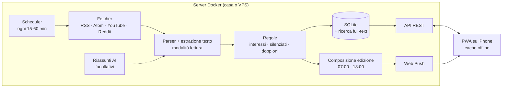

# Galactic Feed · analisi iniziale

Stato: **bozza da confermare**. Le scelte qui sotto sono proposte. Diventano decisioni dopo le risposte alle domande in fondo.

## Obiettivo

Un lettore di notizie personale e self-hosted:

- raccoglie feed RSS/Atom di siti, subreddit e canali YouTube;
- seleziona da solo le notizie che interessano (parole chiave, priorità, parole silenziate) e le impagina come una **edizione** giornaliera, in stile newsletter;
- si legge da una GUI curata, installabile su iPhone come **PWA** (icona sulla Home, schermo intero, offline);
- gira tutto in **Docker** su un server di casa o una VPS.

## Il mockup

La cartella [`mockup/`](../mockup) contiene un prototipo cliccabile della GUI, con dati inventati. Non usa un server né una build:

```bash
python3 -m http.server 8000 --directory mockup
```

Poi apri `http://localhost:8000`. Su un monitor largo l'app compare dentro una cornice da iPhone; su un telefono occupa tutto lo schermo.

Schermate: Edizione del giorno, Flusso con ricerca e filtri, lettura di un articolo (con riassunto automatico facoltativo), post Reddit con commenti, Fonti, Aggiungi fonte (sito, Reddit, YouTube), Interessi e regole, Salvati, Impostazioni.

## Architettura proposta

Il telefono non fa lavoro pesante: su iOS una PWA non può aggiornarsi in background. Il server scarica e filtra i feed a intervalli regolari; la PWA mostra il risultato e manda le notifiche tramite il server.



### Opzioni di stack

| | A. Tutto su misura | B. Motore esistente + GUI nostra | C. Solo software esistente |
|---|---|---|---|
| Backend | Python (FastAPI, feedparser, trafilatura) o Node/TypeScript | [Miniflux](https://miniflux.app) (Go + PostgreSQL) via API | Miniflux o FreshRSS |
| Frontend | PWA nostra (es. Svelte + Vite + vite-plugin-pwa) | PWA nostra | App iOS esistente (es. NetNewsWire, Reeder) |
| Container | 1 (app + SQLite) | 2-3 (Miniflux, Postgres, PWA) | 1-2 |
| Pro | Controllo totale su edizione, punteggi, AI | Parsing dei feed già robusto e collaudato | Zero codice |
| Contro | Più codice da scrivere e mantenere | Edizione e punteggi da costruire sopra la sua API | La GUI non è "tua" |

**Proposta iniziale: A**, perché l'edizione automatica e i punteggi sono il cuore del progetto e con un solo utente SQLite basta. Se preferisci scrivere meno backend, B è un ottimo compromesso.

## Vincoli da conoscere subito

### Reddit (urgente)

- Il 30 settembre 2026 Reddit ha annunciato che **dal 13 novembre 2026 i feed RSS non saranno più disponibili**. Per chi non modera la community "non c'è un sostituto".
- L'accesso pubblico alle API viene chiuso per fasi fino a marzo 2027. Le app di terze parti devono registrarsi ed essere approvate entro il 12 gennaio 2027.
- Da fine 2025 le nuove chiavi API richiedono un'approvazione. Diverse segnalazioni dicono che gli script personali vengono spesso rifiutati.

Opzioni per Reddit, da decidere insieme:

1. usare i feed RSS finché funzionano (circa due settimane) e intanto chiedere l'accesso alle API, senza garanzie;
2. sostituire Reddit con fonti simili che hanno feed aperti (Hacker News, Lemmy, Mastodon, blog e newsletter dei temi seguiti);
3. salvare a mano singoli post dal telefono con un Comando Rapido iOS che manda il link al server;
4. servizi a pagamento di terze parti: da valutare costi e termini d'uso.

Frontend alternativi o scraping delle pagine sono sconsigliati: violano i termini di Reddit e si rompono spesso.

### iPhone e PWA

- **Serve HTTPS** per installare la PWA con service worker e notifiche. Modi semplici: Tailscale (rete privata, nessuna porta aperta), Cloudflare Tunnel, oppure un reverse proxy (Caddy, Traefik, Nginx Proxy Manager) con un dominio e Let's Encrypt.
- **Notifiche push e badge** sull'icona funzionano da iOS 16.4, solo per le web app aggiunte alla Home e dopo un tocco dell'utente che concede il permesso.
- Con **iOS 26** un sito aggiunto alla Home da Safari si apre come web app in modo predefinito.
- **Niente sincronizzazione in background**: i dati si aggiornano all'apertura o con una notifica. Per questo il lavoro lo fa il server.
- Un'**app nativa** (es. con Capacitor) richiede un Mac con Xcode e l'Apple Developer Program (circa 99 €/anno) per installarla in modo stabile o via TestFlight. La PWA evita tutto questo.

## Funzionalità

**MVP (prima versione)**

- Fonti: RSS/Atom (anche ricerca automatica del feed da un sito), canali YouTube, Reddit finché possibile.
- Cartelle, import/export OPML.
- Interessi con priorità, parole silenziate, unione dei doppioni.
- Edizione del mattino composta dal server, Flusso cronologico, ricerca.
- Letti/non letti, salvati disponibili offline, modalità lettura.
- PWA installabile, tema chiaro/scuro, sincronizzazione tra dispositivi (lo stato vive sul server).
- Un solo `docker compose up -d`, immagine per amd64 e arm64 (Raspberry Pi, NAS).

**Dopo**

- Notifiche push per le priorità alte, badge con i non letti.
- Riassunti AI (modello locale con Ollama oppure API esterna).
- Edizione anche via email, punteggio che impara da cosa apri e salvi, più utenti.

## Domande aperte

1. **"Senza che io debba interagire"**: vuoi che l'app scelga da sola le notizie (filtri automatici o AI), o era un refuso per "con cui posso interagire"?
2. **Edizione/newsletter**: ti piace l'idea di un'edizione composta a orari fissi? A che ora? Solo nell'app o anche via email?
3. **Reddit**: quanto è importante? Quali subreddit? Quale delle opzioni sopra preferisci?
4. **Fonti**: quali siti, subreddit e canali vuoi seguire? Più o meno quanti? Hai un file OPML da un altro lettore?
5. **Filtri**: bastano parole chiave e priorità, o vuoi anche l'AI (locale o cloud)? Ti servono i riassunti?
6. **Utenti**: lo usi solo tu, o anche famiglia e amici (servono account separati)?
7. **Dove gira Docker**: Raspberry Pi, NAS (quale), mini PC, VPS?
8. **Accesso da fuori casa**: hai già Tailscale, un dominio o un reverse proxy?
9. **App**: va bene la PWA o vuoi proprio un'app su App Store/TestFlight?
10. **Lettura**: testo completo dentro l'app o anteprima e poi il sito originale? Lettura offline?
11. **Notifiche**: le vuoi? Per cosa?
12. **GUI**: cosa cambieresti del mockup (colori, Edizione/Flusso, densità, tema)? Ti serve anche una versione per iPad o desktop?
13. **Tecnica**: preferenze di linguaggio? Vuoi poterci mettere mano tu?
14. **Costruire o riusare**: va bene la strada A, o preferisci B o C?

## Fonti

- Reddit e RSS: [TechCrunch](https://techcrunch.com/2026/09/30/reddit-is-killing-rss-feeds-ending-public-api-access-because-of-ai-bots/), [Social Media Today](https://www.socialmediatoday.com/news/reddit-ends-support-for-rss-feeds/831844/), [The Next Web](https://thenextweb.com/news/reddit-rss-feeds-shut-down-old-reddit-ai-scraping), [Unite.AI](https://www.unite.ai/reddit-sets-dates-to-retire-rss-feeds-and-close-public-api-access/)
- API Reddit e approvazione: [molehill.pages.dev](https://molehill.pages.dev/blog/reddit_killed_self-service_api_keys_your_options_for_automated_reddit_integration)
- PWA su iOS: [heise (iOS 26)](https://heise.de/-10749652), [MacRumors](https://www.macrumors.com/how-to/save-safari-bookmark-web-app-iphone-home-screen/), [Pushpad](https://pushpad.xyz/blog/ios-special-requirements-for-web-push-notifications), [OneSignal](https://documentation.onesignal.com/docs/ios-web-push)
