# Documentazione di Galactic Feed

Tutto quello che serve per installare, configurare e usare Galactic Feed, e per lavorare sul codice. Ogni pagina si aggiorna nella stessa pull request che cambia l'app: se trovi qualcosa che non torna, apri una issue.

<picture>
  <source media="(prefers-color-scheme: dark)" srcset="img/diagrammi/architettura-scuro.svg">
  
</picture>

## Per chi lo installa

| Pagina | Cosa trovi |
|---|---|
| [Installazione](installazione.md) | Docker Compose con volume o cartella, `docker run`, Raspberry Pi, primo avvio, da sorgente |
| [Configurazione](configurazione.md) | Tutte le variabili d'ambiente, cosa si cambia dal pannello e quale valore vale |
| [Aggiornare e backup](aggiornare-e-backup.md) | Versioni e serie, aggiornare, copia dei dati e ripristino |
| [Dietro un reverse proxy](reverse-proxy.md) | HTTPS, header, esempi per Caddy, Nginx e Traefik, proxy con login |
| [Accesso con OIDC](accesso-oidc.md) | Entrare con Authentik, Authelia, Keycloak, Pocket ID; accesso d'emergenza |
| [Risoluzione dei problemi](risoluzione-problemi.md) | Gli errori più comuni e come uscirne |

## Per chi lo usa

| Pagina | Cosa trovi |
|---|---|
| [Usare l'app](usare-l-app.md) | Oggi con Edizioni e Notiziario, preset e filtri, Cerca, Profilo e statistiche, fonti, interessi, aspetto, lettura e offline |
| [AI, Edizioni e notifiche](ai-edizioni-notifiche.md) | Le tre funzioni facoltative, come accenderle e quanto costano |
| [L'app sul telefono](app-sul-telefono.md) | Installare la PWA su iPhone, Android e computer; aggiornamenti |
| [Glossario](glossario.md) | Edizione, Notiziario, preset, Per te, gruppi di parole… in una riga |

## Per chi lavora sul codice

| Pagina | Cosa trovi |
|---|---|
| [Architettura](ARCHITETTURA.md) | Componenti, database, API, scelte tecniche |
| [Sviluppo](sviluppo.md) | Avvio in locale, test, regole delle PR, versioni, screenshot, diagrammi, pulizia dei branch |
| [Come è fatto](come-e-fatto.md) | Full Vibe Coded: come lavoriamo con l'AI e cosa rende l'app affidabile |
| [Analisi iniziale](storia/ANALISI.md) | I requisiti e le decisioni di partenza (documento d'archivio) |
| [Mockup](../mockup/) | Il prototipo cliccabile della GUI: `python3 -m http.server 8000 --directory mockup` |
| [Novità delle versioni](../CHANGELOG.md) | Cosa cambia in ogni versione |

## Immagini

- **Screenshot** in [`img/screenshot/`](img/screenshot/): li scatta Playwright su un'istanza con dati inventati (vedi [Sviluppo](sviluppo.md#screenshot)).
- **Diagrammi** in [`img/diagrammi/`](img/diagrammi/), in versione chiara e scura: si scrivono in Mermaid in [`diagrammi/`](diagrammi/) e diventano SVG (vedi [Sviluppo](sviluppo.md#diagrammi)).

Nomi, indirizzi e dati negli esempi e nelle immagini sono inventati: domini `example.org`, indirizzi IP riservati alla documentazione (`192.0.2.x`), persone e testate che non esistono.
