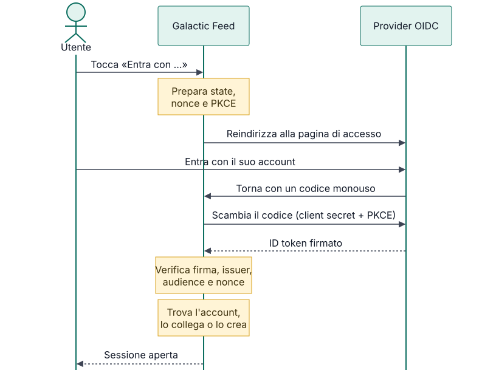

# Accesso con OIDC

Se hai già un sistema di login self-hosted, gli utenti possono entrare con quello, senza un'altra password. Funziona con Authentik, Authelia, Keycloak, Pocket ID e gli altri provider OpenID Connect. Si configura tutto dall'app, in **Amministrazione → Accesso con OIDC**, senza riavviare.

**Non sostituisce gli account locali.** L'amministratore creato al primo avvio e gli utenti invitati continuano a entrare con nome utente e password; il provider aggiunge solo il pulsante «Entra con …». Un caso tipico: un amministratore locale, per le emergenze, e il tuo utente di tutti i giorni dal provider, che rendi amministratore da **Amministrazione → Utenti e inviti → Rendi amministratore**.

## Come funziona

<picture>
  <source media="(prefers-color-scheme: dark)" srcset="img/diagrammi/oidc-scuro.svg">
  
</picture>

L'accesso usa il flusso *authorization code* con PKCE, `state` e `nonce`; l'ID token si verifica con le chiavi del provider (firma, issuer, audience, scadenza, nonce). Il client secret è salvato cifrato e l'app non lo mostra mai.

## Configurazione

1. Nel provider crea un'applicazione (client) **confidenziale** con il flusso *authorization code*. Come indirizzo di ritorno (redirect URI) registra quello mostrato nel pannello: `https://<il tuo indirizzo>/api/auth/oidc/callback`.
2. Nel pannello scrivi l'**issuer** (l'app legge da sola `/.well-known/openid-configuration`), il **client ID**, il **client secret** e il testo del pulsante, per esempio «Entra con Authentik». Poi premi **Prova la configurazione**.
3. Scegli come trattare gli utenti: crearli al primo accesso, oppure collegare quelli esistenti per email verificata o nome utente. Senza creazione automatica serve ancora un invito; poi ognuno collega il suo account da **Impostazioni → Account collegati**.
4. Facoltativo: un gruppo del provider per gli amministratori (claim `groups`, valore per esempio `galactic-admin`). Il gruppo dà i permessi e toglie solo quelli che ha dato lui: chi rendi amministratore a mano resta tale.

Il collegamento automatico (stessa email verificata o stesso nome utente) non tocca mai un amministratore: se il tuo utente del provider si chiama come l'amministratore locale, nasce un account a parte. Per usare il provider anche con l'account locale, collegalo a mano da **Impostazioni → Account collegati**.

## Dove trovare l'issuer

| Provider | Issuer |
|---|---|
| Authentik | `https://auth.example.org/application/o/<slug dell'applicazione>/` |
| Authelia | `https://auth.example.org` |
| Keycloak | `https://auth.example.org/realms/<realm>` |
| Pocket ID | `https://id.example.org` |

## Solo provider

In «Avanzate» il login con password si può spegnere, ma solo dopo aver collegato al provider almeno un amministratore.

## Accesso d'emergenza

Se il login con password è spento e il provider non risponde:

```bash
docker compose exec galactic-feed python -m app.emergency
```

Questo comando riaccende l'accesso con password; con `--reset <nome utente>` stampa anche un link per sceglierne una nuova. In alternativa, la variabile `EMERGENCY_PASSWORD_LOGIN=true` tiene acceso l'accesso con password finché resta impostata (vedi [Configurazione](configurazione.md#variabili-dambiente)).
