# Aggiornare e backup

- [Versioni e serie](#versioni-e-serie)
- [Aggiornare](#aggiornare)
- [Copia dei dati](#copia-dei-dati)
- [Ripristino](#ripristino)
- [Tornare a una versione precedente](#tornare-a-una-versione-precedente)

## Versioni e serie

Le versioni sono numerate `MAGGIORE.MINORE.CORRETTIVA` ([semver](https://semver.org/lang/it/)) e sono elencate, con le novità, nel [CHANGELOG](../CHANGELOG.md) e nelle [release di GitHub](https://github.com/TehMaat/galactic-feed/releases). Finché la versione comincia con `0.` l'app è giovane: le novità arrivano con le versioni minori (0.15, 0.16…), le correzioni con le correttive (0.16.1).

Le immagini sono su GitHub Container Registry, `ghcr.io/tehmaat/galactic-feed`, per amd64, arm64 e armv7:

| Etichetta dell'immagine | Cosa ricevi |
|---|---|
| `0.16` (consigliata) | La serie 0.16 con tutte le sue correzioni |
| `0.16.0` | Esattamente quella versione, senza aggiornamenti |
| `latest` | L'ultima modifica del ramo principale, anche prima di una release |
| `sha-xxxxxxx` | Un commit preciso |

Le versioni di prova, come `0.16.0-rc.1`, hanno solo la loro etichetta e su GitHub sono segnate come pre-release.

## Aggiornare

<picture>
  <source media="(prefers-color-scheme: dark)" srcset="img/diagrammi/aggiornamento-scuro.svg">
  
</picture>

**Correzioni della serie che usi** (per esempio da 0.16.0 a 0.16.1), nella cartella del `docker-compose.yml`:

```bash
docker compose pull
```

```bash
docker compose up -d
```

**Una serie nuova** (per esempio da 0.15 a 0.16):

1. Leggi cosa cambia nel [CHANGELOG](../CHANGELOG.md), soprattutto «Da sapere per aggiornare».
2. Fai una [copia dei dati](#copia-dei-dati).
3. Nel `docker-compose.yml` cambia il numero dell'immagine (`ghcr.io/tehmaat/galactic-feed:0.16`).
4. Ripeti i due comandi qui sopra.

Il database si aggiorna da solo all'avvio. La versione in uso è in **Impostazioni → Informazioni**; l'app installata sui telefoni passa da sola alla versione nuova (vedi [L'app sul telefono](app-sul-telefono.md#aggiornamenti-dellapp-installata)).

## Copia dei dati

Tutto sta nel volume dei dati: il database `galactic-feed.db` e le chiavi `secret.key` e `vapid.pem` (vedi [Configurazione](configurazione.md#i-file-nella-cartella-dei-dati)). Per una copia, ferma il container e salva il volume in un archivio:

```bash
docker compose stop
```

```bash
docker run --rm -v galactic-feed_galactic-data:/data -v "$PWD":/backup debian:stable-slim tar czf /backup/galactic-feed-backup.tgz -C /data .
```

```bash
docker compose start
```

Il nome del volume dipende dalla cartella del progetto: lo vedi con `docker volume ls` (di solito `<cartella>_galactic-data`). Se usi una cartella (`./data:/data`), basta copiare la cartella a container fermo.

## Ripristino

Con il container fermo, svuota il volume e rimetti l'archivio:

```bash
docker compose stop
```

```bash
docker run --rm -v galactic-feed_galactic-data:/data -v "$PWD":/backup debian:stable-slim sh -c "rm -rf /data/* && tar xzf /backup/galactic-feed-backup.tgz -C /data && chown -R 1000:1000 /data"
```

```bash
docker compose start
```

## Tornare a una versione precedente

Gli aggiornamenti del database vanno solo in avanti: una versione vecchia non legge un database già aggiornato. Per tornare indietro rimetti nel `docker-compose.yml` il numero di prima e [ripristina](#ripristino) la copia fatta prima dell'aggiornamento.
