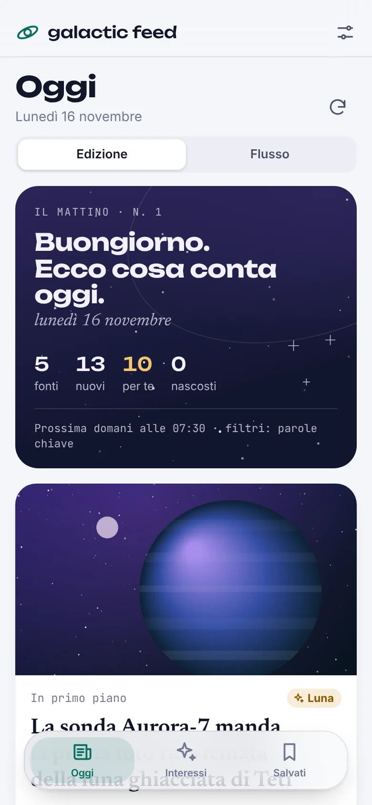

# AI, Edizioni e notifiche

Sono tutte facoltative e si accendono dalle Impostazioni. Senza nessuna delle tre, Galactic Feed è un lettore di feed con filtri a parole chiave.

- [Edizioni](#edizioni)
- [AI](#ai)
- [Notifiche](#notifiche)

## Edizioni

Un'Edizione è una selezione di notizie in stile giornale, composta dal server agli orari che scegli. In **Oggi**, in alto, c'è l'ultima uscita di ogni Edizione accesa, con quante notizie ha; si apre con un tocco, come un articolo. Sotto c'è il Notiziario.

  

In **Impostazioni → Edizioni** crei una o più Edizioni, ognuna con nome, regole e uscite proprie:

- **Quando**: ogni giorno, in alcuni giorni della settimana (per esempio il lunedì) o una volta al mese (il giorno 1, l'ultimo giorno, il primo lunedì…), a uno o più orari, nel tuo fuso orario.
- **Cosa**: senza regole, le notizie per te. Con le regole (tag delle fonti, cartelle, nazioni, gruppi di parole) solo quelle che le rispettano: per esempio «Politica · Italia» con #Politica e Italia, o «Videogiochi» del venerdì con il gruppo Videogiochi.
- L'anteprima dice quante notizie avrebbe adesso; il numero massimo e il periodo coperto si scelgono per ogni Edizione.
- **Componi adesso** prepara subito un'uscita con le notizie arrivate dall'ultima.

Se il server era spento all'orario, l'uscita si compone appena riparte. Di ogni Edizione si tengono le ultime 60 uscite.

## AI

L'AI sceglie le notizie in base a una descrizione libera dei tuoi interessi e scrive riassunti in tre punti. La configura l'amministratore in **Amministrazione → AI**:

- **Locale**: [Ollama](https://ollama.com) su un computer della tua rete, o un altro server compatibile con l'API di OpenAI. Scrivi l'indirizzo con `/v1` in fondo (per esempio `http://192.0.2.20:11434/v1`) e il nome del modello (quello che vedi con `ollama list`). I testi non escono da casa; su un Raspberry Pi è molto lento, meglio un PC.
- **Cloud**: Anthropic (Claude) oppure OpenAI, con la chiave API del servizio, salvata cifrata. Il modello predefinito per Claude è `claude-opus-5-5`; per scegliere e riassumere notizie basta `claude-haiku-5-5`, che costa molto meno. Si paga a consumo e titoli e testi degli articoli vengono inviati al servizio.
- Il **tetto di richieste al giorno** limita la spesa; **Prova il collegamento** dice subito se qualcosa non va. Dopo un errore il server si ferma 15 minuti prima di riprovare.

Poi ogni utente, negli **Interessi**, sceglie tra parole chiave, AI o entrambi, descrive cosa gli interessa e può accendere i riassunti automatici. Il server manda al modello gli articoli delle ultime 48 ore a lotti di 20; ogni articolo si valuta una volta sola, e un riassunto scritto vale per tutti.

## Notifiche

In **Impostazioni → Notifiche** si accendono per ogni dispositivo. Poi scegli le categorie importanti (le cartelle): ti avviso quando arriva una notizia per te, al massimo una volta ogni 10 minuti, e, se vuoi, quando è pronta un'Edizione. Sull'icona dell'app compare il numero di non letti.

- Su iPhone e iPad le notifiche arrivano solo nell'app aggiunta alla schermata Home (iOS 16.4 o successivo), e serve HTTPS (vedi [L'app sul telefono](app-sul-telefono.md)).
- Il server deve poter raggiungere i servizi push dei browser (Google, Mozilla, Apple, Microsoft) su Internet. Il contenuto delle notifiche è cifrato: quei servizi non lo leggono.
- La chiave delle notifiche è `vapid.pem` nella cartella dei dati: se la perdi, ogni dispositivo deve riaccenderle.
