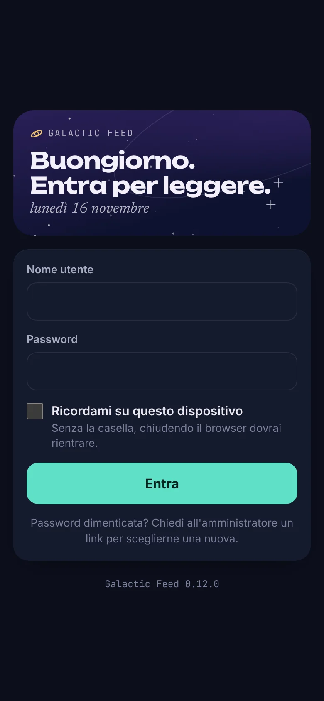
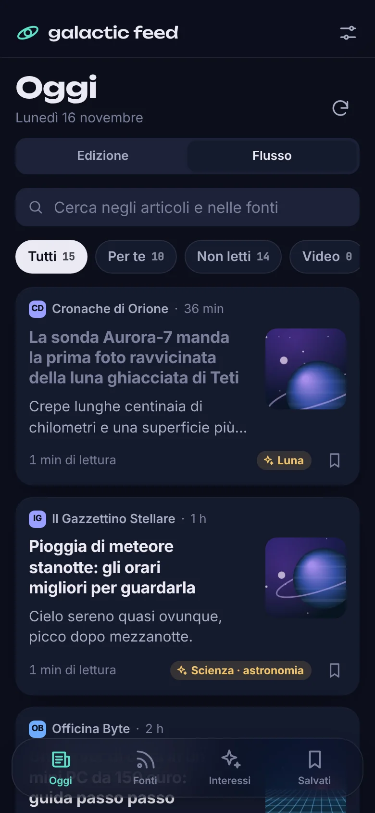

# L'app sul telefono

Galactic Feed è una PWA: si installa dal browser, senza store, e si apre a schermo intero come un'app. Per installarla serve l'indirizzo in **HTTPS** (vedi [Dietro un reverse proxy](reverse-proxy.md)).

  
  

## iPhone e iPad (Safari)

1. Apri l'indirizzo in Safari ed entra con il tuo account.
2. Tocca il pulsante Condividi, poi **Aggiungi alla schermata Home**, poi **Aggiungi**.
3. Apri Galactic Feed dall'icona: si apre a schermo intero, come un'app.

L'icona è nera, nello stile delle icone Apple, e sta bene sia con la schermata Home chiara sia con quella scura.

Le notifiche su iPhone e iPad arrivano solo nell'app aggiunta alla schermata Home, con iOS 16.4 o successivo. L'app installata ha cookie separati da Safari: la prima volta si entra di nuovo.

## Android (Chrome)

Menu ⋮, poi **Installa app** o **Aggiungi a schermata Home**.

## Computer (Chrome, Edge)

L'icona di installazione nella barra degli indirizzi.

## Aggiornamenti dell'app installata

Quello che cambia nell'app (schermate, pulsanti, correzioni) arriva da solo: l'app cerca la versione nuova quando la riapri e ogni ora mentre è aperta. Se la trova appena riaperta e non stai leggendo, si ricarica da sola; altrimenti in basso compare «È disponibile una nuova versione» con il pulsante **Aggiorna**. La versione in uso, e il pulsante **Cerca aggiornamenti**, sono in **Impostazioni → Informazioni**.

Solo **icona e nome** sulla schermata Home restano quelli del momento in cui hai aggiunto l'app, perché iOS li salva allora e non li ricontrolla: per vederli cambiati togli l'app dalla schermata Home e aggiungila di nuovo. Account e dati restano sul server.

## In background e offline

Su iPhone l'app non si aggiorna in background: le notizie le scarica sempre il server, e l'app le prende quando la apri. I salvati e gli ultimi 300 articoli letti restano leggibili anche offline. Quello che segni o salvi senza rete parte quando la rete torna, quando riapri l'app o al massimo entro un minuto.

All'uscita dall'account, o se entra un altro account sullo stesso dispositivo, le copie offline si cancellano.
