# Come è fatto

## Full Vibe Coded

Galactic Feed è **Full Vibe Coded**: codice, test, workflow, documentazione, diagrammi e screenshot li scrive l'AI (Claude Code). Una persona decide cosa fare, prova l'app, legge le pull request e le approva. Nessuna riga è scritta a mano.

Questo non vuol dire «senza regole». Anzi: proprio perché il codice lo scrive l'AI, le regole sono scritte e controllate dalle macchine.

<picture>
  <source media="(prefers-color-scheme: dark)" srcset="img/diagrammi/versione-scuro.svg">
  
</picture>

## Cosa lo rende affidabile

- **Ogni modifica parte da una issue** e arriva come pull request: si vede sempre cosa cambia e perché. Quando la persona propone qualcosa, è Claude ad aprire la issue prima di cominciare, e la PR la chiude.
- **Test automatici** su ogni PR: pytest per il server (con feed e siti finti, senza chiamate a Internet), vitest per la logica della PWA, Playwright nel browser con il server vero, e una prova del container Docker.
- **Ogni PR che cambia l'app è una versione nuova**, con le note nel [CHANGELOG](../CHANGELOG.md): il job «versione» fallisce se manca. Immagini, tag e release li pubblica solo il workflow, mai a mano.
- **La documentazione cambia con l'app**, nella stessa PR, e il job «documenti» controlla che non resti indietro (vedi [Sviluppo](sviluppo.md#documentazione-sempre-aggiornata)).
- **Le regole per l'AI** sono in [`CLAUDE.md`](../CLAUDE.md), nel repository: chiunque può leggerle.
- **Dati inventati** negli esempi, negli screenshot e nei test: nessun nome, indirizzo o chiave veri.

## Avvertenza

È un progetto personale, pensato per una famiglia o un gruppo di amici. Funziona, è testato e si aggiorna spesso, ma nessuno garantisce supporto o tempi. Usalo sapendo com'è fatto, tieni una [copia dei dati](aggiornare-e-backup.md#copia-dei-dati) e, se trovi un problema, apri una issue.
