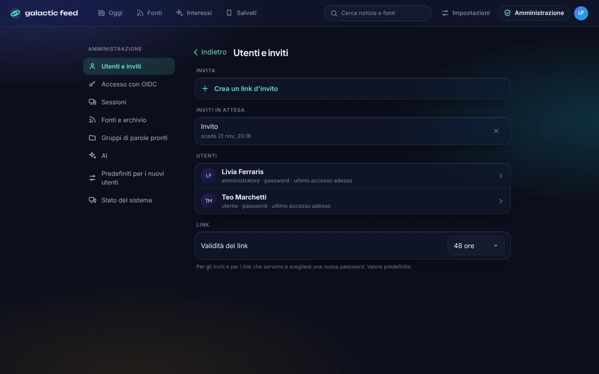

# Configurazione

Quasi tutto si configura dall'app, senza riavviare. Le variabili d'ambiente servono per le poche cose da decidere prima dell'avvio e, se vuoi, come valore iniziale delle impostazioni del pannello.

- [Quale valore vale](#quale-valore-vale)
- [Variabili d'ambiente](#variabili-dambiente)
- [Dal pannello di amministrazione](#dal-pannello-di-amministrazione)
- [Preferenze di ogni utente](#preferenze-di-ogni-utente)
- [I file nella cartella dei dati](#i-file-nella-cartella-dei-dati)

## Quale valore vale

<picture>
  <source media="(prefers-color-scheme: dark)" srcset="img/diagrammi/impostazioni-scuro.svg">
  
</picture>

Ogni impostazione del pannello mostra da dove arriva il valore: scelto nell'app, dalla variabile d'ambiente o predefinito. Il valore scelto nell'app vale più della variabile d'ambiente, e si può riportare al predefinito.

## Variabili d'ambiente

Si scrivono nel `docker-compose.yml`, sotto `environment:`, poi `docker compose up -d`. Esempio:

```yaml
    environment:
      PUBLIC_URL: "https://notizie.example.org"
      TZ: "Europe/Rome"
      FORWARDED_ALLOW_IPS: "172.18.0.5"
      RETENTION_DAYS: "180"
```

**Solo all'avvio**: si leggono quando il server parte e si cambiano **solo** qui.

| Variabile | Predefinito | A cosa serve | Esempio |
|---|---|---|---|
| `PUBLIC_URL` | `http://localhost:8080` | Indirizzo pubblico completo dell'app: link d'invito, manifest della PWA, controllo dell'origine delle richieste, user agent del fetcher | `https://notizie.example.org` |
| `DATA_DIR` | `/data` | Cartella del database e delle chiavi (vedi sotto) | `/data` |
| `FORWARDED_ALLOW_IPS` | `*` | Da quali indirizzi accettare gli header `X-Forwarded-*` del reverse proxy (vedi [Dietro un reverse proxy](reverse-proxy.md)) | `172.18.0.5` |
| `LOG_LEVEL` | `info` | Dettaglio del log: `debug`, `info`, `warning` | `debug` |
| `PORT` | `8080` | Porta interna del container | `8080` |
| `HOST` | `0.0.0.0` | Indirizzo su cui il server ascolta dentro il container. Serve solo in casi particolari (sviluppo, test) | `127.0.0.1` |
| `FRONTEND_DIR` | `/app/frontend` nell'immagine, `frontend/dist` da sorgente | Cartella della PWA compilata. Nell'immagine è già giusta; serve per lo sviluppo | `../frontend/dist` |
| `EMERGENCY_PASSWORD_LOGIN` | `false` | Con `true` l'accesso con password resta acceso anche se l'amministratore l'ha spento (emergenza OIDC, vedi [Accesso con OIDC](accesso-oidc.md#accesso-demergenza)) | `true` |

**Valore iniziale di un'impostazione del pannello**: valgono finché l'amministratore non sceglie un altro valore in **Amministrazione**.

| Variabile | Predefinito | A cosa serve | Valori nel pannello |
|---|---|---|---|
| `TZ` | `Europe/Rome` | Fuso orario del log e dell'istanza: orari delle Edizioni per chi non ne ha scelto uno | qualsiasi fuso, es. `Europe/Rome`, `UTC` |
| `RETENTION_DAYS` | `90` | Dopo quanti giorni si cancellano gli articoli non salvati | 14, 30, 60, 90, 180, 365, 730 |
| `BLOCK_PRIVATE_NETWORKS` | `false` | Con `true` non si possono aggiungere fonti della rete di casa (indirizzi privati), redirect compresi | sì / no |
| `REMEMBER_DAYS` | `90` | Durata di un accesso con «Ricordami», in giorni dall'ultimo utilizzo | 7, 30, 90, 180, 365 |
| `SESSION_HOURS` | `12` | Senza «Ricordami»: dopo quante ore senza usare l'app bisogna rientrare | 1, 4, 12, 24, 72 |
| `INVITE_HOURS` | `48` | Per quante ore valgono i link d'invito e quelli per una nuova password | 24, 48, 72, 168 |

I valori sì/no valgono «sì» con `true`, `1`, `yes`, `si`, `sì` oppure `on`, e «no» con qualsiasi altra cosa. Nei numeri la variabile può avere anche valori diversi da quelli del pannello; un numero non valido viene ignorato e vale il predefinito. Un fuso orario sconosciuto in `TZ` viene ignorato allo stesso modo.

Questa tabella è controllata dai test: se il server legge una variabile che qui non c'è, o viceversa, il job «documenti» fallisce (vedi [Sviluppo](sviluppo.md#documentazione-sempre-aggiornata)).

## Dal pannello di amministrazione

**Impostazioni** (`/impostazioni`) e **Amministrazione** (`/amministrazione`, solo per gli amministratori) sono pagine: sul computer si aprono dalla barra in alto, a destra, e occupano tutta la larghezza, con l'indice delle sezioni a sinistra. Su telefono e tablet le Impostazioni si aprono dall'icona in alto a destra e l'Amministrazione da lì. Le modifiche valgono subito, senza riavviare.

- **Utenti e inviti**: inviti, nuove password, permessi, validità dei link; per ogni utente si vede se entra con la password, con il provider OIDC o con entrambi.
- **Accesso con OIDC**: il pulsante «Entra con …» di un provider (vedi [Accesso con OIDC](accesso-oidc.md)).
- **Sessioni**: durata delle sessioni con e senza «Ricordami».
- **Fonti e archivio**: per quanti giorni tenere gli articoli, ogni quanto controllare le fonti nuove (15 minuti – 1 giorno, predefinito 30 minuti), fonti della rete di casa sì o no, nazione dei feed.
- **Gruppi di parole pronti**: quelli proposti a tutti negli Interessi.
- **AI**: fornitore, modello, chiave (salvata cifrata) e limite giornaliero (vedi [AI, Edizioni e notifiche](ai-edizioni-notifiche.md)).
- **Predefiniti per i nuovi utenti**: tema e sue varianti, colore, font, Edizione e orari con cui parte chi si iscrive.
- **Stato del sistema**: versione, spazio occupato, ultimo controllo dei feed, errori recenti, fuso orario, variabili d'avvio.

<p align="center">
  
</p>

## Preferenze di ogni utente

Ognuno, in **Impostazioni**, sceglie per sé: account e sessioni aperte, Edizioni, notifiche, uso dell'AI, aspetto, lettura. Le scelte valgono su tutti i suoi dispositivi. I dettagli sono in [Usare l'app](usare-l-app.md).

## I file nella cartella dei dati

Tutto sta in `/data` (o nella cartella di `DATA_DIR`):

| File | Cosa contiene |
|---|---|
| `galactic-feed.db` (con `-wal` e `-shm`) | Il database SQLite: utenti, fonti, articoli, preferenze |
| `secret.key` | La chiave che cifra i segreti nel database (chiave dell'AI, client secret OIDC). Senza questa, quei segreti vanno reinseriti |
| `vapid.pem` | La chiave delle notifiche push. Se la perdi, ogni dispositivo deve riaccenderle |

Come copiarli e ripristinarli è in [Aggiornare e backup](aggiornare-e-backup.md#copia-dei-dati).
