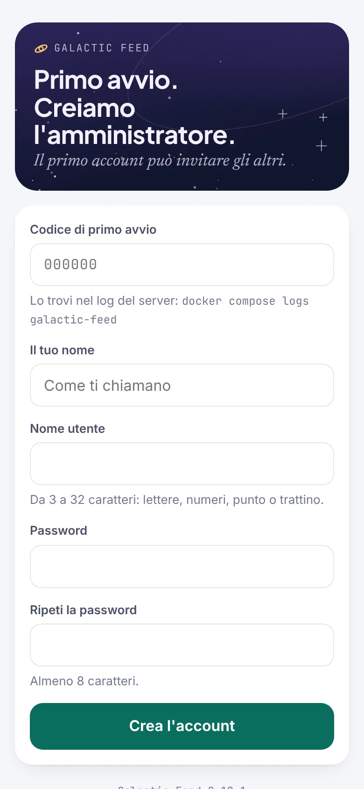
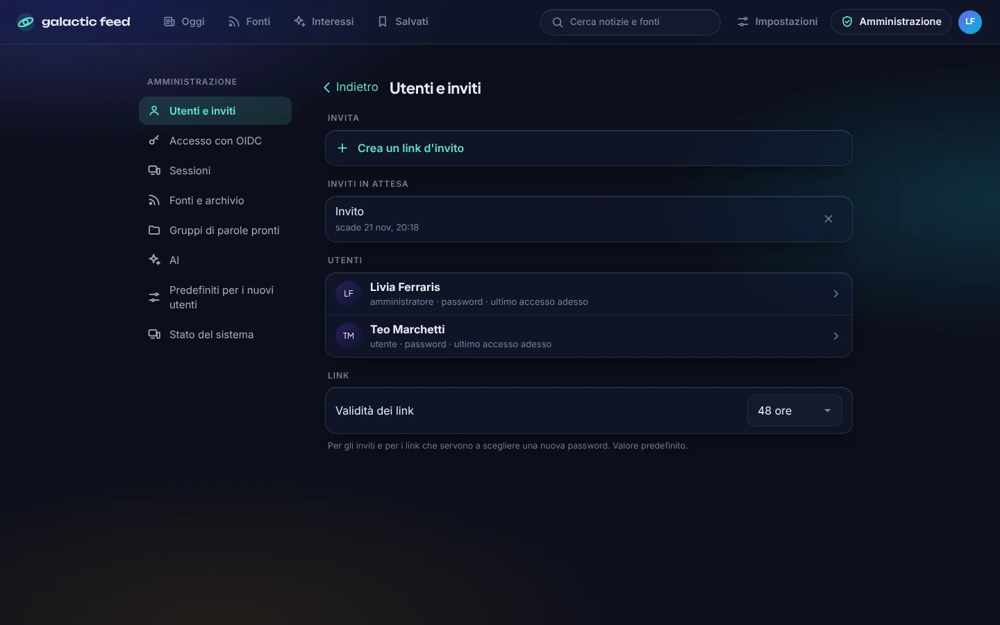

# Installazione

Galactic Feed è un solo container Docker che contiene il server e l'app. Gira su PC e server (amd64), Raspberry Pi 4/5 e Mac con Apple Silicon (arm64), Raspberry Pi a 32 bit (armv7). I dati stanno in un file SQLite nella cartella `/data` del container.

<picture>
  <source media="(prefers-color-scheme: dark)" srcset="img/diagrammi/installazione-scuro.svg">
  
</picture>

- [Cosa serve](#cosa-serve)
- [Docker Compose (consigliato)](#docker-compose-consigliato)
- [Primo avvio](#primo-avvio)
- [Con una cartella invece del volume](#con-una-cartella-invece-del-volume)
- [Con `docker run`](#con-docker-run)
- [Raspberry Pi e NAS](#raspberry-pi-e-nas)
- [Dietro un reverse proxy](#dietro-un-reverse-proxy)
- [Costruire l'immagine da sé](#costruire-limmagine-da-sé)
- [Da sorgente, per sviluppo](#da-sorgente-per-sviluppo)

## Cosa serve

- Docker con il plugin Compose (`docker compose version` risponde).
- Un indirizzo da cui aprire l'app. Per installarla sui telefoni e ricevere le notifiche serve **HTTPS**, che fa il reverse proxy che hai già (vedi [Dietro un reverse proxy](reverse-proxy.md)).

## Docker Compose (consigliato)

1. Crea una cartella, per esempio `galactic-feed`, e mettici il file [`docker-compose.yml`](../docker-compose.yml) di questo repository:

   ```yaml
   services:
     galactic-feed:
       image: ghcr.io/tehmaat/galactic-feed:0.12
       container_name: galactic-feed
       restart: unless-stopped
       ports:
         - "8080:8080"
       environment:
         PUBLIC_URL: "https://notizie.example.org"
         TZ: "Europe/Rome"
       volumes:
         - galactic-data:/data

   volumes:
     galactic-data:
   ```

2. Cambia `PUBLIC_URL` con l'indirizzo da cui aprirai l'app. Serve per i link d'invito e per riconoscere le richieste che arrivano dall'app. Le altre variabili sono in [Configurazione](configurazione.md).
3. Avvia:

   ```bash
   docker compose up -d
   ```

L'etichetta `:0.12` riceve da sola le correzioni della serie 0.12; come passare alla serie successiva è in [Aggiornare e backup](aggiornare-e-backup.md).

## Primo avvio

Cerca il **codice di primo avvio** nel log:

```bash
docker compose logs galactic-feed
```

Trovi un riquadro così:

```text
── Galactic Feed · primo avvio ──
Apri https://notizie.example.org e crea l'amministratore.
Codice di primo avvio: 291619
```

Apri l'indirizzo, inserisci il codice e crea il tuo account: sei l'amministratore. Gli altri utenti li inviti da **Amministrazione → Utenti e inviti**, con un link valido 48 ore.

<p align="center">
  
  
</p>

Il codice cambia a ogni riavvio, e dopo troppi tentativi sbagliati, finché non esiste un account. Serve solo a evitare che qualcun altro crei l'amministratore prima di te.

## Con una cartella invece del volume

Se preferisci vedere i file, nel `docker-compose.yml` scrivi `./data:/data` al posto di `galactic-data:/data` (e togli la sezione `volumes:` in fondo). La cartella deve appartenere all'utente del container (uid 1000), che non è root:

```bash
mkdir -p data && sudo chown -R 1000:1000 data
```

Se i permessi non vanno bene, il log lo dice con un messaggio chiaro e il comando da usare.

## Con `docker run`

Senza Compose, lo stesso container si avvia così:

```bash
docker volume create galactic-data
```

```bash
docker run -d --name galactic-feed --restart unless-stopped -p 8080:8080 -e PUBLIC_URL=https://notizie.example.org -e TZ=Europe/Rome -v galactic-data:/data ghcr.io/tehmaat/galactic-feed:0.12
```

Il codice di primo avvio si legge con `docker logs galactic-feed`.

## Raspberry Pi e NAS

L'immagine è la stessa per tutte le architetture: Docker scarica da solo quella giusta.

- **Raspberry Pi 4 e 5** con un sistema a 64 bit usano `arm64`; con Raspberry Pi OS a 32 bit `armv7`.
- Tieni il volume `/data` su un disco USB o SSD se puoi: le schede SD si consumano con le scritture del database.
- L'AI in locale su un Raspberry Pi è molto lenta: meglio Ollama su un altro computer della rete, o un servizio cloud (vedi [AI, Edizioni e notifiche](ai-edizioni-notifiche.md)).
- Sui NAS (Synology, QNAP, Unraid…) si usa il `docker-compose.yml` dalla loro interfaccia per i progetti Compose; se usi una cartella, assegnala all'uid 1000.

## Dietro un reverse proxy

Galactic Feed non gestisce HTTPS: lo fa il reverse proxy. Con il proxy sulla stessa macchina conviene pubblicare la porta solo in locale, `"127.0.0.1:8080:8080"`, così l'app si raggiunge solo passando dal proxy. Esempi completi in [Dietro un reverse proxy](reverse-proxy.md).

## Costruire l'immagine da sé

Le immagini pronte sono su GitHub Container Registry, `ghcr.io/tehmaat/galactic-feed`. Per costruirla dal sorgente:

```bash
docker build -t galactic-feed .
```

Poi nel `docker-compose.yml` scrivi `image: galactic-feed`.

## Da sorgente, per sviluppo

Serve Python 3.12 e Node 22. I passi sono in [Sviluppo](sviluppo.md#avvio-in-locale).
