# Dietro un reverse proxy

Galactic Feed non gestisce HTTPS: lo fa il reverse proxy che hai già (Caddy, Traefik, Nginx, Nginx Proxy Manager, Pangolin…). L'HTTPS serve, perché su iPhone e Android la PWA si installa, il service worker funziona e le notifiche arrivano solo con HTTPS.

<picture>
  <source media="(prefers-color-scheme: dark)" srcset="img/diagrammi/reverse-proxy-scuro.svg">
  
</picture>

## Le quattro cose da sistemare

1. **Inoltro**: il proxy manda le richieste a `http://<host>:8080`, o `http://galactic-feed:8080` se è nella stessa rete Docker. Non servono WebSocket.
2. **Header**: il proxy deve passare `Host`, `X-Forwarded-Proto` e `X-Forwarded-For`. Lo fanno quasi tutti in automatico. Con `X-Forwarded-Proto: https` il cookie di accesso diventa `Secure`. `X-Forwarded-For` dà l'indirizzo vero di chi si collega, che serve al limite dei tentativi di accesso.
3. **`FORWARDED_ALLOW_IPS`**: dice da quali indirizzi fidarsi di quegli header. Il predefinito `*` va bene se il container si raggiunge **solo** dal proxy. In quel caso, nel `docker-compose.yml`, pubblica la porta come `"127.0.0.1:8080:8080"` oppure non pubblicarla e metti proxy e app nella stessa rete Docker. Se la porta 8080 è aperta anche ad altri, scrivi l'indirizzo del proxy, per esempio `FORWARDED_ALLOW_IPS=172.18.0.5`.
4. **`PUBLIC_URL`**: deve essere l'indirizzo HTTPS completo che usi nel browser, per esempio `https://notizie.example.org`.

## Esempi

**Caddy** (`Caddyfile`): HTTPS e header in automatico.

```caddyfile
notizie.example.org {
    reverse_proxy galactic-feed:8080
}
```

**Nginx**:

```nginx
server {
    listen 443 ssl;
    server_name notizie.example.org;
    # ssl_certificate e ssl_certificate_key come per gli altri siti

    location / {
        proxy_pass http://127.0.0.1:8080;
        proxy_set_header Host $host;
        proxy_set_header X-Forwarded-Proto $scheme;
        proxy_set_header X-Forwarded-For $proxy_add_x_forwarded_for;
    }
}
```

**Traefik** (etichette nel `docker-compose.yml`, con Traefik nella stessa rete Docker e un certificato già configurato):

```yaml
    labels:
      - "traefik.enable=true"
      - "traefik.http.routers.galactic-feed.rule=Host(`notizie.example.org`)"
      - "traefik.http.routers.galactic-feed.entrypoints=websecure"
      - "traefik.http.routers.galactic-feed.tls=true"
      - "traefik.http.services.galactic-feed.loadbalancer.server.port=8080"
```

**Nginx Proxy Manager** e simili: un «proxy host» verso `galactic-feed` porta `8080`, schema `http`, con il certificato SSL attivo e «Force SSL».

## Se il proxy chiede un login

Alcuni proxy (Pangolin, Authelia o oauth2-proxy davanti alle app…) chiedono un loro login prima di arrivare all'app. Galactic Feed ha già i suoi account, quindi quel login non serve. Se vuoi tenerlo, lascia aperti questi indirizzi, altrimenti la PWA non si installa o non si aggiorna:

- `/manifest.webmanifest`: il browser lo scarica senza cookie;
- `/sw.js`: il service worker;
- `/icons/*`: le icone dell'app e della schermata Home.

Nei proxy con regole per percorso si fa con una regola di «bypass» per ciascun percorso. Ricorda anche che su iPhone l'app installata ha cookie separati da Safari: la prima volta dovrai rifare il login del proxy dentro l'app.

Per entrare con lo stesso account del tuo sistema di login, senza un'altra password, usa invece l'[accesso con OIDC](accesso-oidc.md).
