# Sviluppo

Come avviare Galactic Feed dal sorgente, provarlo e pubblicare una versione. Com'è fatto il codice è in [Architettura](ARCHITETTURA.md); il modo di lavorare con l'AI in [Come è fatto](come-e-fatto.md).

- [Avvio in locale](#avvio-in-locale)
- [Test](#test)
- [Regole delle pull request](#regole-delle-pull-request)
- [Versioni e rilascio](#versioni-e-rilascio)
- [Documentazione sempre aggiornata](#documentazione-sempre-aggiornata)
- [Screenshot](#screenshot)
- [Diagrammi](#diagrammi)
- [Pulizia dei branch](#pulizia-dei-branch)
- [Immagini Docker](#immagini-docker)

## Avvio in locale

Serve Python 3.12 e Node 22.

```bash
python3.12 -m venv .venv && . .venv/bin/activate && pip install -r backend/requirements-dev.txt
```

```bash
cd frontend && npm ci
```

Per lavorare sull'interfaccia avvia il server, poi Vite in un altro terminale. Vite manda le chiamate `/api` al server sulla porta 8080.

```bash
cd backend && DATA_DIR=../data python -m app
```

```bash
cd frontend && npm run dev
```

Il codice di primo avvio è nel log del server.

## Test

```bash
cd backend && python -m pytest
```

```bash
cd frontend && npm test
```

```bash
cd frontend && npm run build && npx playwright test
```

I test del server usano feed e siti finti, senza chiamate a Internet. Playwright avvia un sito di notizie finto e il server vero (vedi `frontend/e2e/server.mjs`).

Il workflow [Test](../.github/workflows/test.yml) li esegue su ogni PR, insieme ai job «versione» e «documenti».

## Regole delle pull request

- **Ogni PR che cambia l'app è una versione nuova**: `backend/app`, `frontend/src`, `frontend/public`, `frontend/index.html`, `Dockerfile` o le dipendenze. Il job «versione» fallisce se la PR tocca questi file e non cambia `VERSION`. Le PR di soli test, documenti o workflow no.
- **La documentazione si aggiorna nella stessa PR** (vedi sotto).
- Il titolo o la descrizione della PR dicono la versione.
- Le istruzioni per Claude sono in [`CLAUDE.md`](../CLAUDE.md).

## Versioni e rilascio

<picture>
  <source media="(prefers-color-scheme: dark)" srcset="img/diagrammi/versione-scuro.svg">
  
</picture>

Il numero di versione sta solo nel file [`VERSION`](../VERSION); lo script lo copia nei pacchetti e i test controllano che coincidano.

1. Nella PR scrivi le modifiche nella sezione «Da pubblicare» di `CHANGELOG.md` (Novità, Correzioni, Da sapere per aggiornare), poi prepara la versione: la sezione prende il numero nuovo.

   ```bash
   python3 scripts/release.py bump minor   # novità: 0.8.0 → 0.9.0
   python3 scripts/release.py bump patch   # solo correzioni: 0.8.0 → 0.8.1
   ```

   Lo script aggiorna `VERSION`, i pacchetti e il `docker-compose.yml` d'esempio. Con una versione minore aggiorna anche i numeri della serie nelle docs (README, [Installazione](installazione.md), [Aggiornare e backup](aggiornare-e-backup.md)): il job «documenti» fallisce finché non coincidono.

2. Fai il merge della PR su `main`. Il workflow [Immagine Docker](../.github/workflows/docker.yml) vede che il tag della versione (per esempio `v0.9.0`) non esiste ancora: pubblica le immagini `:0.9.0` e `:0.9`, poi crea il tag e la release con le note del `CHANGELOG.md`. Nessun tag a mano.

Una versione come `0.7.0-rc.1` diventa una versione di prova: solo `:0.7.0-rc.1`, segnata come pre-release.

```bash
python3 scripts/release.py check
```

controlla che `VERSION`, pacchetti e CHANGELOG coincidano.

## Documentazione sempre aggiornata

<picture>
  <source media="(prefers-color-scheme: dark)" srcset="img/diagrammi/documenti-scuro.svg">
  
</picture>

Ogni PR che cambia comportamento, schermate, variabili o installazione aggiorna le pagine di `docs/` e il README nella stessa PR. Il job «documenti» del workflow Test esegue

```bash
python3 scripts/docs.py check
```

e fallisce se:

- una variabile d'ambiente letta dal server non è nella tabella di [Configurazione](configurazione.md#variabili-dambiente), o la tabella ne ha una che il server non legge più;
- un link interno (file, immagine, ancora) nel README, in `CLAUDE.md`, nel CHANGELOG o in `docs/` non porta da nessuna parte;
- un diagramma è cambiato senza rigenerare le sue immagini, o un'immagine non ha più il suo sorgente;
- compaiono dati che sembrano veri: indirizzi IP fuori da quelli di documentazione (`192.0.2.x`, `198.51.100.x`, `203.0.113.x`; ammessi anche `127.0.0.1` e le reti di Docker `172.16.0.0/12`), email non `@example.org`, host di una rete di casa (`.lan`, `.local`, `.home`…);
- manca il badge «Full Vibe Coded» nel README o in [docs/README.md](README.md);
- la serie consigliata scritta nelle docs (`galactic-feed:0.10`, «`0.10` (consigliata)») non è quella di `VERSION`.

Negli esempi si usano sempre dati inventati: domini `example.org`, persone e testate di fantasia, chiavi palesemente false.

## Screenshot

Gli screenshot in [`img/screenshot/`](img/screenshot/) li scatta Playwright su un'istanza preparata apposta, con dati inventati: l'amministratrice «Livia Ferraris», l'utente «Teo Marchetti», cinque testate che non esistono («Cronache di Orione», «Il Gazzettino Stellare», «Officina Byte», «Rete & Circuiti», «Pedale Lento») servite da un sito finto locale, interessi e un'Edizione «Il Mattino». Telefono e computer, tema chiaro e scuro, in WebP senza metadati.

```bash
cd frontend && npm run build && npx playwright test -c playwright.screenshots.config.js
```

Lo script è in `frontend/screenshots/`; per una schermata nuova aggiungi uno `shot(page, "nome")` e usala nelle docs. Il workflow [Screenshot](../.github/workflows/screenshot.yml) li rifà da solo dopo ogni merge su `main` che cambia l'interfaccia e, se sono cambiati, apre (o aggiorna) la PR «Screenshot aggiornati»; si può lanciare anche a mano. Perché possa aprire la PR, in **Settings → Actions → General** del repository va acceso «Allow GitHub Actions to create and approve pull requests». Le PR aperte dal workflow non fanno partire i test da sole: per farli girare chiudi e riapri la PR, o aggiungi un commit.

## Diagrammi

I diagrammi si scrivono in [Mermaid](https://mermaid.js.org/) in [`diagrammi/`](diagrammi/), uno per file `.mmd`, e diventano due SVG in [`img/diagrammi/`](img/diagrammi/): `<nome>-chiaro.svg` e `<nome>-scuro.svg`, con i colori dell'app. Niente schemi in ASCII: nelle docs si usano le immagini.

```bash
python3 scripts/docs.py diagrammi
```

Serve Node (lo script usa `@mermaid-js/mermaid-cli` con `npx`). Se c'è già un Chromium, indicalo con `PUPPETEER_EXECUTABLE_PATH`. Ogni SVG porta l'impronta del suo sorgente: il job «documenti» si accorge se il sorgente è cambiato e le immagini no. Il workflow [Diagrammi](../.github/workflows/diagrammi.yml) li rigenera anche da solo, sulle PR che cambiano un `.mmd`, e aggiunge il commit al branch della PR.

Nelle pagine si mostrano così, e GitHub sceglie quello del tema di chi legge:

```html
<picture>
  <source media="(prefers-color-scheme: dark)" srcset="img/diagrammi/nome-scuro.svg">
  
</picture>
```

## Pulizia dei branch

Il workflow [Pulizia dei branch](../.github/workflows/pulizia-branch.yml) cancella i branch che non servono più.

<picture>
  <source media="(prefers-color-scheme: dark)" srcset="img/diagrammi/pulizia-branch-scuro.svg">
  
</picture>

| Caso | Cosa succede |
|---|---|
| PR **mergiata** | Il branch si cancella subito, al merge (se dopo il merge non ha commit nuovi) |
| Tutto il branch è **già in `main`** | Si cancella al giro settimanale |
| PR **chiusa senza merge** | Si cancella dopo **14 giorni** dalla chiusura |
| Nessuna PR, ultimo commit più vecchio di **30 giorni** | Si cancella, solo per i branch da lavoro: `claude/`, `feature/`, `fix/`, `docs/`, `chore/` |
| Ultimo commit negli ultimi **7 giorni** | **Mai** toccato: può esserci qualcuno al lavoro |
| PR **aperta**, anche in bozza | **Mai** toccato |
| `main`, branch protetti, prefisso `keep/` | **Mai** toccati |

Il giro completo parte ogni lunedì notte. Lanciato a mano da **Actions → Pulizia dei branch → Run workflow** parte in **prova**: il riepilogo del job elenca cosa cancellerebbe e perché, senza cancellare; togli la spunta «prova» per farlo davvero. I numeri di giorni e i prefissi stanno in cima al workflow. Per tenere un branch per sempre, chiamalo `keep/…`.

## Immagini Docker

Le immagini sono su GitHub Container Registry: `ghcr.io/tehmaat/galactic-feed`.

- `0.10` e `0.10.0`: le versioni pubblicate (vedi [Aggiornare e backup](aggiornare-e-backup.md#versioni-e-serie));
- `latest`: l'ultima versione del ramo principale;
- `sha-xxxxxxx`: un commit preciso.

Le costruisce il workflow [Immagine Docker](../.github/workflows/docker.yml) per amd64, arm64 e armv7; sulle PR solo la build e una prova del container. Dopo la prima pubblicazione il pacchetto su GHCR è privato: per scaricarlo senza login, rendilo pubblico da GitHub, alla voce **Packages → galactic-feed → Package settings → Change visibility**.
