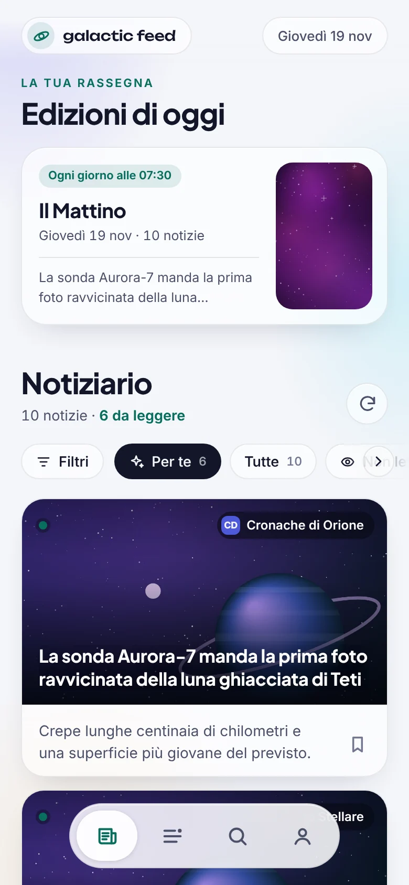
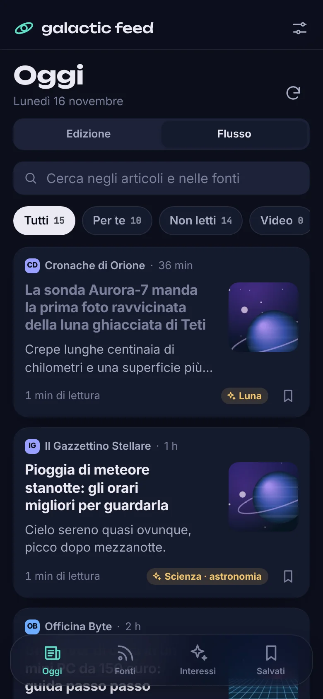
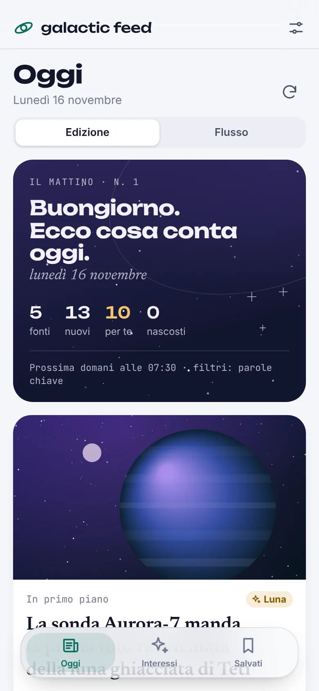
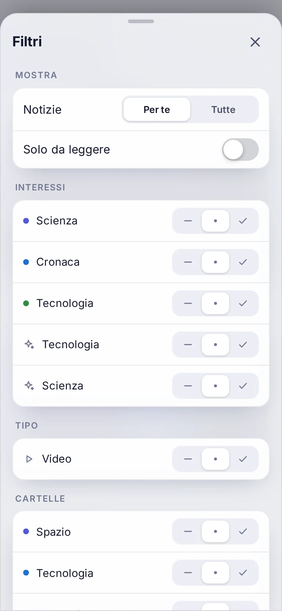
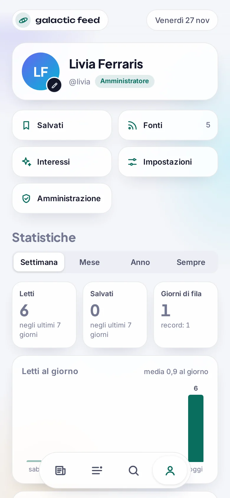
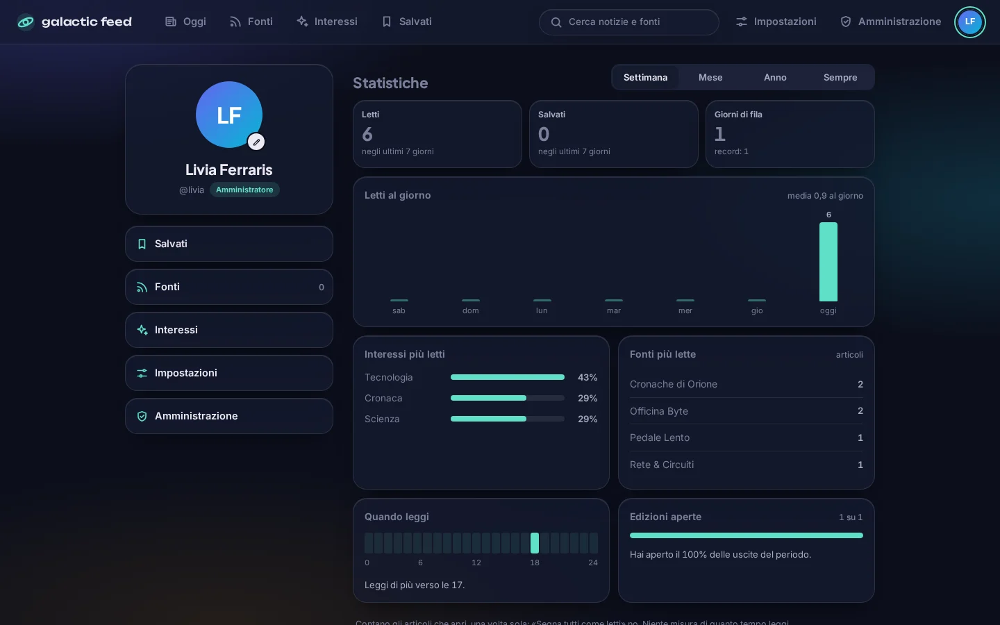
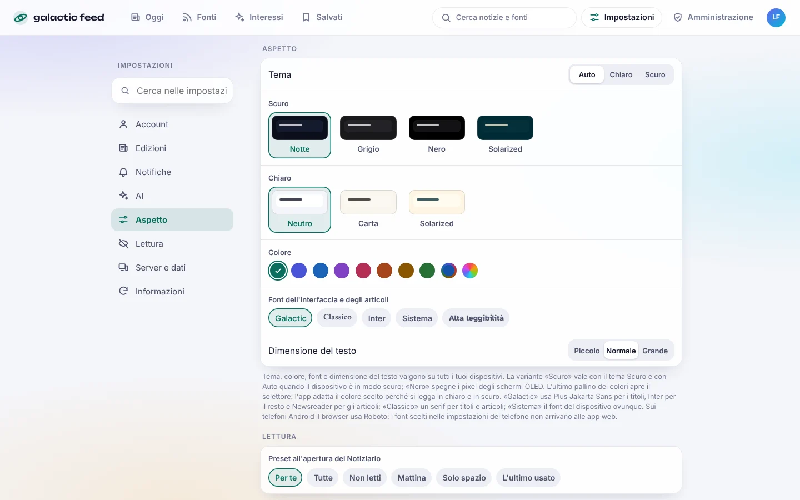
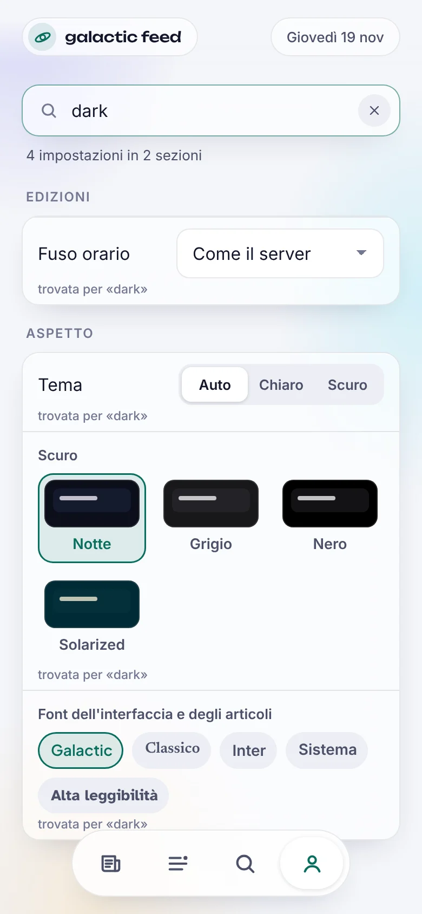
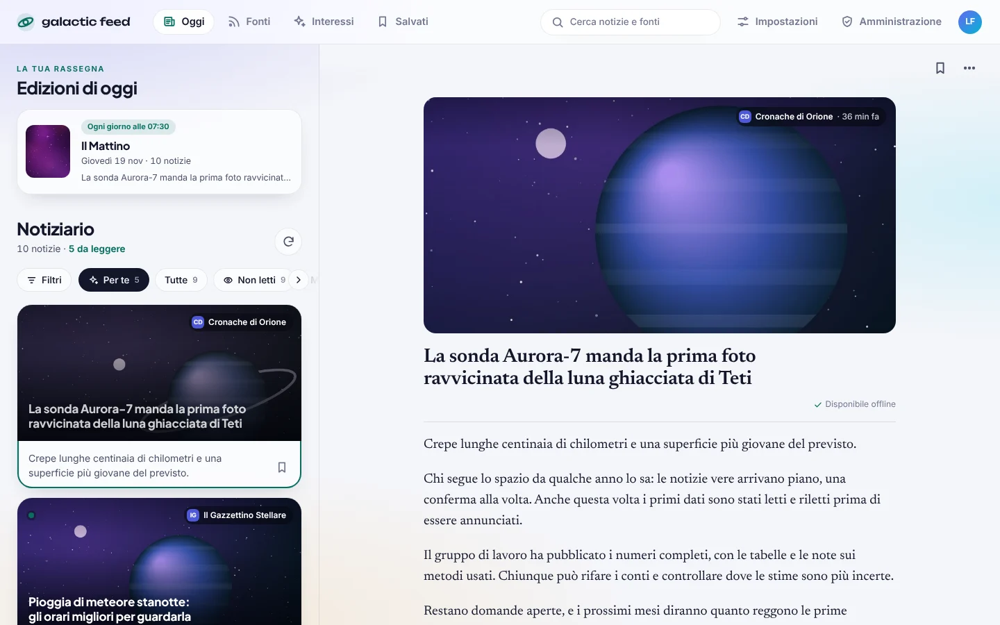

# Usare l'app

- [Oggi: Edizioni e Notiziario](#oggi-edizioni-e-notiziario)
- [Filtri e preset del Notiziario](#filtri-e-preset-del-notiziario)
- [Cerca](#cerca)
- [Profilo e statistiche](#profilo-e-statistiche)
- [Fonti](#fonti)
- [Interessi, gruppi di parole e doppioni](#interessi-gruppi-di-parole-e-doppioni)
- [Tag e nazioni delle fonti](#tag-e-nazioni-delle-fonti)
- [Leggere, salvare e offline](#leggere-salvare-e-offline)
- [Aspetto](#aspetto)
- [Telefono, tablet e computer](#telefono-tablet-e-computer)

## Oggi: Edizioni e Notiziario

**Oggi** è la schermata principale. In alto ci sono le **Edizioni di oggi**: per ogni [Edizione](ai-edizioni-notifiche.md#edizioni) accesa l'ultima uscita, in una card più grande di quelle delle notizie: la copertina a tutta larghezza con sopra l'etichetta delle sue regole, quante notizie restano da leggere, la data, quante notizie ha e il nome; sotto, il titolo d'apertura. Un'Edizione già letta ha la foto spenta. Si apre con un tocco, come un articolo: sopra Oggi sul telefono, a destra sul computer. Da un articolo dell'Edizione «Indietro» riporta all'Edizione.

Sotto, nello stesso scroll, c'è il **Notiziario**: tutti gli articoli delle tue fonti, in ordine di arrivo. Sotto il titolo c'è quante notizie ci sono con i filtri in uso e quante sono da leggere («24 notizie · 7 da leggere»); il numero scende mentre leggi. Il pulsante tondo accanto controlla subito le fonti. Senza Edizioni Oggi mostra solo il Notiziario.

Ogni notizia è una card: sopra la foto a tutta larghezza con il titolo e, in alto a destra, l'icona e il nome della fonte; sotto l'estratto e il segnalibro per salvarla. Un punto colorato in alto a sinistra indica quelle da leggere; quelle lette hanno la foto più spenta. Se l'articolo non ha un'immagine, l'app ne disegna una.

  
  
  

## Filtri e preset del Notiziario

Sopra le notizie c'è la riga dei **preset**: tre pronti (**Per te**, le notizie che toccano un tuo interesse; **Tutte**; **Non letti**) e quelli che crei tu. Accanto a ogni preset c'è quante notizie da leggere ha. Quando la riga non ci sta tutta, il bordo sfuma e una freccia la fa scorrere.

Il pulsante **Filtri** apre il pannello con tutto il resto:

- **Mostra**: Per te o Tutte, e «Solo da leggere».
- **Interessi** (tag delle fonti e gruppi di parole accesi come interesse), **Tipo** (video), **Cartelle**, **Nazioni** (se le fonti sono di più nazioni) e **Fonti**. Ogni voce ha tre stati: **–** nasconde quelle notizie, **·** nessun filtro, **✓** tiene solo quelle. Tra gli interessi inclusi ne basta uno; tra tipi diversi (per esempio un interesse e una fonte) devono valere tutti; le esclusioni tolgono sempre.
- **Preset**: con un nome salvi i filtri in uso, che compaiono sulla riga. Da qui si cancellano.
- **All'apertura del Notiziario**: da quale preset si parte quando apri l'app. Se non scegli niente, «Per te»; con «L'ultimo usato» ritrovi i filtri dell'ultima volta. Si sceglie anche in **Impostazioni → Lettura**.
- **Segna tutte come lette**, sulle notizie dei filtri in uso.

I filtri, esclusioni comprese, restano salvati anche quando chiudi l'app. Se cambi i filtri senza salvarli, sotto la riga compare il riepilogo («Tutte · solo Spazio · senza Motori») con **Salva come preset** e **Azzera**. «Mostra gli articoli» nella scheda di una fonte apre il Notiziario con solo quella fonte.

  

## Cerca

**Cerca** trova le parole negli articoli e nei nomi delle fonti; basta l'inizio di una parola («galass» trova «galassie»). Sopra i risultati ci sono le fonti con quel nome (un tocco apre il Notiziario con solo quella fonte) e quante notizie ha trovato, con quante da leggere.

## Profilo e statistiche

Il **Profilo** (nella Dock sul telefono, l'avatar in alto a destra sul computer) mostra chi sei e le scorciatoie per Salvati, Fonti, Interessi, Impostazioni e, per gli amministratori, Amministrazione.

- **Nome e avatar**: tocca l'avatar (o **Impostazioni → Account → Nome e avatar**) per cambiare il nome e scegliere una foto o le iniziali su un colore. La foto viene ridotta dall'app prima di arrivare al server. Il nome utente per entrare non cambia.
- **Statistiche**, per **settimana** (ultimi 7 giorni), **mese** (ultimi 30), **anno** (ultimi 12 mesi) o **di sempre** (dal primo articolo aperto o salvato): articoli letti (con il confronto con il periodo prima, tranne «di sempre»), salvati, giorni di fila con almeno un articolo letto, un grafico dei letti (per giorno; sull'anno per mese; «di sempre» per giorno, mese o anno secondo quanto tempo è passato), interessi e fonti più letti, le ore del giorno in cui leggi e quante uscite delle Edizioni hai aperto. Contano gli articoli che apri, una volta sola; «Segna tutti come letti» no. L'app non misura quanto tempo leggi.
- Sul telefono sotto le statistiche ci sono le sezioni delle **Impostazioni** e «Cerca nelle impostazioni».

  
  

## Fonti

In **Fonti** aggiungi un sito, un feed o un canale YouTube. Sul computer Fonti è nella barra in alto; su telefono e tablet si apre dal **Profilo**, con «Indietro» per tornare.

- **Basta l'indirizzo del sito**: il server cerca da solo il feed nella pagina. Se ne trova più d'uno (tutte le notizie, una categoria) scegli tu; i feed dei commenti non vengono proposti.
- **YouTube**: il link del canale o `@nome` bastano, il server ricava il feed pubblico. Non serve un account.
- **Cartelle**: ogni fonte sta in una cartella, che si rinomina, colora o elimina dalla matita accanto al titolo.
- **Ogni quanto controllarla**: di solito ogni 30 minuti; si cambia dalla scheda della fonte. Il server rispetta gli header di cache dei siti e dirada i controlli quando un sito dà errore.
- **OPML**: importi le fonti da un altro lettore o le esporti, dal fondo della pagina Fonti.
- **Icone**: accanto a ogni fonte compare l'icona del sito o l'avatar del canale YouTube, trovata in automatico. Dalla scheda della fonte la puoi aggiornare, sostituire con un'altra immagine o togliere per tornare alle iniziali.

  

Siti senza feed non sono supportati. Se un sito blocca i programmi automatici, in Fonti compare un errore chiaro.

## Interessi, gruppi di parole e doppioni

In **Interessi** decidi cosa finisce in «Per te». Tutto il resto resta nel Notiziario.

- **Come scegliere**: parole chiave, [AI](ai-edizioni-notifiche.md#ai) o entrambi.
- **Parole chiave** con priorità alta o media (un tocco la cambia). Il confronto è per parole intere su titolo, estratto e categorie, senza badare a maiuscole e accenti; per l'italiano si riconoscono singolare e plurale («razzo» ↔ «razzi»).
- **Gruppi di parole**: trovi gruppi pronti (Motori, Politica, Economia, Tecnologia, Videogiochi, Sport, Calcio, Scienza, Salute, Spettacolo, Cronaca). Con un tocco li accendi come interesse o per silenziare i loro articoli; puoi cambiarne le parole o creare i tuoi. L'amministratore gestisce i gruppi pronti in Amministrazione.
- **Parole silenziate**: gli articoli che le contengono spariscono.
- **Doppioni**: la stessa notizia da più fonti (stesso link, o titolo quasi uguale nei 3 giorni intorno) diventa una scheda sola, con «anche su: …». Segnare come letto vale per tutta la notizia. Si può spegnere.

In cima, il riquadro dice quante notizie delle ultime 24 ore sarebbero per te con le regole di adesso.

  

## Tag e nazioni delle fonti

- **Tag delle fonti**: quando aggiungi una fonte l'app propone fino a tre tag (per esempio #Tecnologia) guardando titoli e categorie degli articoli. Li tieni, li togli o ne aggiungi altri dalla scheda della fonte; quelli che togli non tornano. I tag accesi compaiono tra gli interessi nei Filtri del Notiziario; in **Fonti → Tag delle fonti** li rinomini, colori, ordini, unisci o togli dai Filtri.
- **Nazione delle fonti**: proposta dal dominio (.it, .co.uk…) e dalla lingua del feed. La cambi per te dalla scheda della fonte; l'amministratore la corregge per tutti in **Amministrazione → Fonti e archivio**. Con fonti di più nazioni le nazioni compaiono nei Filtri del Notiziario e come filtro nelle Fonti.

## Leggere, salvare e offline

- **Testo completo**: se il feed dà solo un estratto, il server prova a estrarre il testo dalla pagina del sito, ripulito da pubblicità e script. Sui siti a pagamento resta l'estratto.
- **Nascondere gli articoli senza testo completo**: in **Impostazioni → Lettura**. Non compaiono nel Notiziario, nelle Edizioni e nelle notifiche; i salvati restano. Nel Notiziario un avviso dice quanti sono e li mostra con un tocco; nella scheda della fonte c'è scritto «Spesso solo estratto».
- **Salvati**: restano finché non li togli, anche dopo il periodo di conservazione degli articoli e anche se smetti di seguire la fonte.
- **Offline**: i salvati e gli ultimi 300 articoli letti restano leggibili senza rete, con le loro immagini. Quello che segni o salvi senza rete parte quando la rete torna.
- **Il lettore**: in cima c'è la foto, con la fonte e l'ora di pubblicazione in alto a destra. In alto ci sono solo Indietro, Salva e «⋯». Nel menu «⋯» trovi la dimensione del testo, Condividi (dove il dispositivo lo permette), Apri l'originale e Segna come non letto; in fondo all'articolo c'è «Leggi su …». Scorrendo verso il basso la barra esce dallo schermo e rientra tornando su; una riga sottile in alto mostra quanto hai letto.
- **Sul computer** l'articolo può stare accanto all'elenco o aprirsi a pagina intera sopra di esso: si sceglie in **Impostazioni → Lettura**. «Indietro» o Esc riportano all'elenco.
- Niente commenti o voti: Galactic Feed è di sola lettura. Il link all'originale c'è sempre.

  
  

## Aspetto

In **Impostazioni → Aspetto** ognuno sceglie tema (automatico, chiaro, scuro), la variante dello scuro (Notte, Grigio, Nero per gli schermi OLED, o Solarized) e del chiaro (Neutro, Carta o Solarized), il colore principale, il font e la dimensione del testo. Le scelte valgono su tutti i suoi dispositivi. Le superfici sono in vetro sfocato sopra aloni di colore che cambiano con la variante; con Nero gli aloni non ci sono.

  

- I **colori** stanno su una riga sola. L'ultimo pallino apre il selettore per un **colore personalizzato**: l'app lo scurisce in chiaro e lo schiarisce in scuro quanto basta perché testo e pulsanti si leggano (contrasto AA).
- Il **colore del sistema** funziona solo dove il browser lo fa conoscere, soprattutto Firefox sui computer. Chrome, Edge e i telefoni Android danno sempre lo stesso blu, e una web app non può leggere i colori di Material You: il campione in Impostazioni mostra il colore che arriva davvero. Anche questo viene adattato perché si legga.
- Il **font** vale per interfaccia e articoli insieme. **Galactic** usa Plus Jakarta Sans per i titoli, Inter per il resto e Newsreader per gli articoli; **Classico** Newsreader per titoli e articoli; **Inter** e **Alta leggibilità** (Atkinson Hyperlegible) lo stesso font ovunque; **Sistema** quello del dispositivo (San Francisco su iPhone e Mac, Segoe UI su Windows). Sui telefoni Android il browser usa Roboto: i font scelti nelle impostazioni del telefono non arrivano alle web app. Tutti tranne Sistema sono inclusi nell'app e funzionano anche offline.
- **Cerca nelle impostazioni**: in cima alle Impostazioni (sul computer nella colonna a sinistra). Restano visibili e usabili solo le voci che corrispondono, con la parola evidenziata; capisce anche qualche sinonimo («dark» trova il tema, «token» il fornitore AI) e lo dice sotto la voce. Sul telefono il campo sparisce scorrendo verso il basso e torna appena risali.

  

## Telefono, tablet e computer

- **Telefono**: in alto il nome dell'app e la data, in basso la Dock a pillola con **Oggi**, **Notiziario** (solo se hai Edizioni: scorre fino alle notizie e si accende quando ci arrivi), **Cerca** e **Profilo**. Fonti, Interessi, Salvati, Impostazioni e Amministrazione si aprono dal Profilo. Scorrendo verso il basso le barre escono dallo schermo e rientrano tornando su.
- **Tablet**: come il telefono, con contenuti più larghi.
- **Computer**: barra in vetro in alto con Oggi, Fonti, Interessi e Salvati a sinistra, Cerca, Impostazioni, Amministrazione e il tuo avatar (il Profilo) a destra. Elenco a sinistra e lettura o Edizione a destra, oppure articolo a pagina intera.

  

