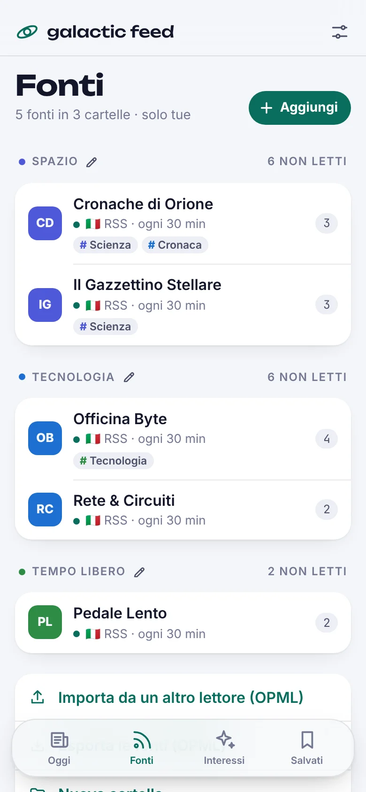
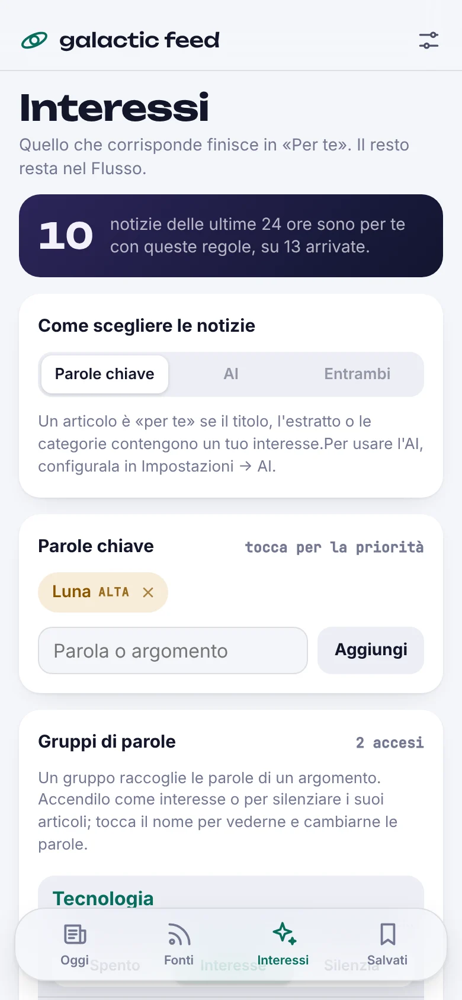
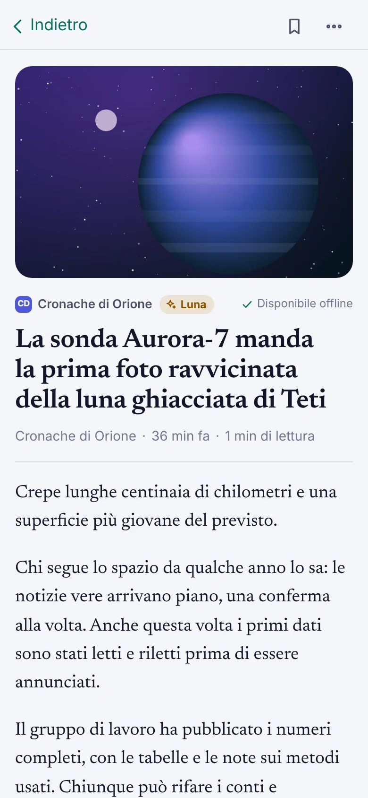

# Usare l'app

- [Oggi: Flusso ed Edizione](#oggi-flusso-ed-edizione)
- [Fonti](#fonti)
- [Interessi, gruppi di parole e doppioni](#interessi-gruppi-di-parole-e-doppioni)
- [Tag e nazioni delle fonti](#tag-e-nazioni-delle-fonti)
- [Leggere, salvare e offline](#leggere-salvare-e-offline)
- [Aspetto](#aspetto)
- [Telefono, tablet e computer](#telefono-tablet-e-computer)

## Oggi: Flusso ed Edizione

**Oggi** è la schermata principale. Il **Flusso** mostra gli articoli in ordine di arrivo, con la ricerca e i filtri: Tutti, **Per te** (quelli che toccano un tuo interesse), Non letti, Video, e una chip per ogni tag delle fonti che vuoi vedere lì. Ogni scheda dice la fonte, da quanto è uscito, il tempo di lettura e, se c'è, l'interesse che l'ha scelta.

Se hai un'[Edizione](ai-edizioni-notifiche.md#edizioni) accesa, in alto c'è il selettore **Edizione / Flusso**; sul telefono e sul tablet si passa dall'una all'altro anche con uno swipe orizzontale.

  
  

## Fonti

In **Fonti** aggiungi un sito, un feed o un canale YouTube. Sul computer Fonti è nella barra in alto; su telefono e tablet si apre da **Impostazioni → Fonti**, con «Indietro» per tornare.

- **Basta l'indirizzo del sito**: il server cerca da solo il feed nella pagina. Se ne trova più d'uno (tutte le notizie, una categoria) scegli tu; i feed dei commenti non vengono proposti.
- **YouTube**: il link del canale o `@nome` bastano, il server ricava il feed pubblico. Non serve un account.
- **Cartelle**: ogni fonte sta in una cartella, che si rinomina, colora o elimina dalla matita accanto al titolo.
- **Ogni quanto controllarla**: di solito ogni 30 minuti; si cambia dalla scheda della fonte. Il server rispetta gli header di cache dei siti e dirada i controlli quando un sito dà errore.
- **OPML**: importi le fonti da un altro lettore o le esporti, dal fondo della pagina Fonti.
- **Icone**: accanto a ogni fonte compare l'icona del sito o l'avatar del canale YouTube, trovata in automatico. Dalla scheda della fonte la puoi aggiornare, sostituire con un'altra immagine o togliere per tornare alle iniziali.

  

Siti senza feed non sono supportati. Se un sito blocca i programmi automatici, in Fonti compare un errore chiaro.

## Interessi, gruppi di parole e doppioni

In **Interessi** decidi cosa finisce in «Per te». Tutto il resto resta nel Flusso.

- **Come scegliere**: parole chiave, [AI](ai-edizioni-notifiche.md#ai) o entrambi.
- **Parole chiave** con priorità alta o media (un tocco la cambia). Il confronto è per parole intere su titolo, estratto e categorie, senza badare a maiuscole e accenti; per l'italiano si riconoscono singolare e plurale («razzo» ↔ «razzi»).
- **Gruppi di parole**: trovi gruppi pronti (Motori, Politica, Economia, Tecnologia, Videogiochi, Sport, Calcio, Scienza, Salute, Spettacolo, Cronaca). Con un tocco li accendi come interesse o per silenziare i loro articoli; puoi cambiarne le parole o creare i tuoi. L'amministratore gestisce i gruppi pronti in Amministrazione.
- **Parole silenziate**: gli articoli che le contengono spariscono.
- **Doppioni**: la stessa notizia da più fonti (stesso link, o titolo quasi uguale nei 3 giorni intorno) diventa una scheda sola, con «anche su: …». Segnare come letto vale per tutta la notizia. Si può spegnere.

In cima, il riquadro dice quante notizie delle ultime 24 ore sarebbero per te con le regole di adesso.

  

## Tag e nazioni delle fonti

- **Tag delle fonti**: quando aggiungi una fonte l'app propone fino a tre tag (per esempio #Tecnologia) guardando titoli e categorie degli articoli. Li tieni, li togli o ne aggiungi altri dalla scheda della fonte; quelli che togli non tornano. Nel Flusso ogni tag può avere la sua chip; in **Fonti → Tag delle fonti** li rinomini, colori, ordini e unisci.
- **Nazione delle fonti**: proposta dal dominio (.it, .co.uk…) e dalla lingua del feed. La cambi per te dalla scheda della fonte; l'amministratore la corregge per tutti in **Amministrazione → Fonti e archivio**. Con fonti di più nazioni compaiono le chip delle nazioni nel Flusso e il filtro nelle Fonti.

## Leggere, salvare e offline

- **Testo completo**: se il feed dà solo un estratto, il server prova a estrarre il testo dalla pagina del sito, ripulito da pubblicità e script. Sui siti a pagamento resta l'estratto.
- **Nascondere gli articoli senza testo completo**: in **Impostazioni → Lettura**. Non compaiono nel Flusso, nell'Edizione e nelle notifiche; i salvati restano. Nel Flusso un avviso dice quanti sono e li mostra con un tocco; nella scheda della fonte c'è scritto «Spesso solo estratto».
- **Salvati**: restano finché non li togli, anche dopo il periodo di conservazione degli articoli e anche se smetti di seguire la fonte.
- **Offline**: i salvati e gli ultimi 300 articoli letti restano leggibili senza rete, con le loro immagini. Quello che segni o salvi senza rete parte quando la rete torna.
- **Il lettore**: in alto ci sono solo Indietro, Salva e «⋯». Nel menu «⋯» trovi la dimensione del testo, Condividi (dove il dispositivo lo permette), Apri l'originale e Segna come non letto; in fondo all'articolo c'è «Leggi su …». Scorrendo verso il basso la barra esce dallo schermo e rientra tornando su; una riga sottile in alto mostra quanto hai letto.
- **Sul computer** l'articolo può stare accanto all'elenco o aprirsi a pagina intera sopra di esso: si sceglie in **Impostazioni → Lettura**. «Indietro» o Esc riportano all'elenco.
- Niente commenti o voti: Galactic Feed è di sola lettura. Il link all'originale c'è sempre.

  
  

## Aspetto

In **Impostazioni → Aspetto** ognuno sceglie tema (automatico, chiaro, scuro), la variante dello scuro (Notte, Grigio o Nero, per gli schermi OLED) e del chiaro (Neutro o Carta), colore principale, font dell'interfaccia e degli articoli e dimensione del testo. Le scelte valgono su tutti i suoi dispositivi.

  

- Il **colore del sistema** funziona solo dove il browser lo fa conoscere, soprattutto Firefox sui computer. Chrome, Edge e i telefoni Android danno sempre lo stesso blu, e una web app non può leggere i colori di Material You: il campione in Impostazioni mostra il colore che arriva davvero. Il colore viene scurito in chiaro e schiarito in scuro quanto basta perché si legga (contrasto AA).
- Il font **Sistema** usa quello del dispositivo anche per i titoli (San Francisco su iPhone e Mac, Segoe UI su Windows); **Galactic** lo usa per tutto tranne i titoli, in Unbounded. Sui telefoni Android il browser usa Roboto: i font scelti nelle impostazioni del telefono non arrivano alle web app. Inter e Alta leggibilità (Atkinson Hyperlegible) sono inclusi nell'app e funzionano anche offline.

## Telefono, tablet e computer

- **Telefono**: la Dock in basso ha Oggi, Interessi e Salvati, con una capsula sotto la sezione aperta; scorrendo le barre escono dallo schermo. Impostazioni (e da lì Fonti e Amministrazione) si aprono dall'icona in alto a destra.
- **Tablet**: navigazione in una barra laterale.
- **Computer**: barra in alto con Oggi, Fonti, Interessi e Salvati; elenco e lettura affiancati, o articolo a pagina intera; Impostazioni e Amministrazione a destra.

  

